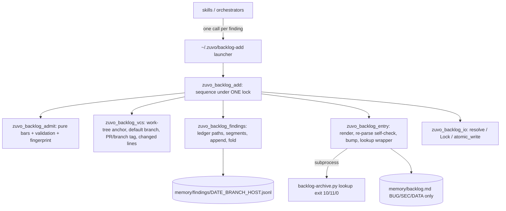

# Implementation Plan: Backlog noise bar, part 1 of 3: `backlog-add` and the findings ledger

**Spec:** inline, no spec
**spec_id:** none
**planning_mode:** inline
**source_of_truth:** inline brief (owner-approved 2026-10-13, relayed request from the tgm backlog intake)
**plan_revision:** 6
**status:** Approved
**Created:** 2026-10-13
**Tasks:** 8
**Estimated complexity:** 4 complex, 4 standard

## Context

This is part 1 of 3 sequential plans. Each one ships as its own PR and lands before the next is planned (rule 17).

| Part | Scope | Lands |
|------|-------|-------|
| 1 | The `backlog-add` single write path, the findings ledger, central policy prose, the production-path rule | this plan |
| 2 | Rewire about 105 write sites in 31 skills, 11 includes and 15 agent files, plus the paragraph guard test | planned after part 1 merges, against the CLI as shipped |
| 3 | Read side: `findings query/mark/export/compact`, reader hooks in refactor-radar, code-audit and structure-audit, and the dup-map export | planned after part 2 |

**Why the change is needed.** On 2026-10-12 the downstream intake retired 2,951 open zuvo-written entries: 1,345 were noise, 866 were already fixed, and 740 cited files that are absent from the default branch. About 45% of new entries are rejected.

**What the owner wants.**
- `memory/backlog.md` holds only work that becomes tickets.
- Every finding is still kept, as data, so that reports like the hub's `tgm-survey-platform/duplicated-code` can be built from what has accumulated. Today they are rebuilt from scratch by scout runs.

**External contract** (tgm-caretaker 2af315d), which the downstream intake already parses:
- `[pr:<N>]`: the entry waits while the PR is open, gets ticketed on merge, and is retired on decline.
- `[branch:<name>]`: the branch is resolved to its newest PR. With no PR yet, the entry waits. A branch deleted without a PR retires the entry, except SEC entries.
- **Allowed characters in the branch name are exactly `[A-Za-z0-9._/-]`.**
- The intake does not read the findings ledger.

## Architecture Summary



The new modules import `zuvo_backlog_parse as zb` in the `import` form and never call `iter_entries`, so H19c's `*)` default (`0 0 - 0 0 -`) holds for them. The one exception is `zuvo_backlog_entry.self_check`. It makes one pinned call (`kinds=(zb.KIND_CHECKBOX,)`), which Task 4 records as a per-file H19c arm, raising the aggregate pinned count from 8 to 9 on purpose.

`backlog-archive.py` (770 of 800 lines) and `zuvo_backlog_parse.py` (786 lines, H10 frozen snapshot) are **not edited**.

## Technical Decisions

1. **Single write path under one lock.**
   - `zio.Lock(dirname(real backlog))` is held once. Under it the helper folds the ledger, runs at most 2 `lookup` subprocesses (about 0.07 s each, measured), writes `backlog.md` and appends to the ledger. This closes the append race `B-backlog-flock` for every caller of `backlog-add`.
   - `mkdir -p` the memory directory before taking the lock. Today `Lock` on a missing `memory/` exits 1, forever.
2. **Ledger.**
   - Location: `dirname(real backlog)/findings/<YYYY-MM-DD>_<branch-slug>_<host>.jsonl`. The ledger sits beside the backlog (same location rule) and is segmented by day, branch and host. Segments mean no merge conflicts in tracked repos (GitHub applies no merge drivers), no Mac/ryzen clobbering through ccsync, and a bounded file size.
   - Append-only. Every write is one of three line kinds:
     - a **full record** (has `class`);
     - a **sighting line** (`{"v":1,"id":…,"ts":…,"sighting":{…source, sha, branch, pr}}`);
     - a **status patch** (`{"v":1,"id":…,"ts":…,"status":…,"backlog":…,"note":…}`).
   - The fold works as follows:
     - `seen` = 1 + the number of sighting lines, counted across all segments. Counting events, not storing absolute values, avoids undercounts across branch lineages.
     - Status and backlog patches apply after full records, ordered by (`ts`, segment file name, line index), so ties are broken the same way within a segment and across segments. A patch that is older than its record still applies, because Mac and ryzen clocks skew.
     - Named defects are reported, never raised: a torn tail, an orphan patch, bad JSON, or an unknown `v`.
   - Before appending, the writer adds `\n` when the file does not end in one, so a torn tail never glues onto the next line.
   - Record schema v1, using dup-map names where they overlap: `v, id, ts, class, confidence, severity, title, how, fix, anchor, files[{path,line,note}], target, area, agent, source, branch, pr, sha, route, reason, backlog, status, forced`. The key set is frozen by a golden test (T2). The status vocabulary is closed: `found` (default), `ticketed` (it has a backlog id), `fixed`, `refuted`, `kept`. Part 3's dup-map export maps `fixed` → `merged`.
   - Visibility: the check asks git about the SEGMENT path (`memory/findings/<seg>.jsonl`), never the bare directory. `git check-ignore memory/findings` returns "not ignored" while the directory is absent, even when `/memory/findings/` is in `.gitignore`. Verified in a scratch repo. A tracked `findings/` directory beside an ignored backlog is refused with exit 3 (`REFUSED tracked-findings-beside-ignored-backlog`), with the `.gitignore` recipe. This is the same rule as `zuvo_backlog_ledger.refuse_tracked_ledger`, reused through a shared function rather than copied. The one difference is the exit code, which is explained beside it.
3. **Fingerprint (F-id = `F-` + sha1[:12]).**
   - BUG, SEC and DATA findings with an anchor: `CLASS | repo-relative path | normalised anchor`, where normalising collapses whitespace and lowercases. Two skills that paraphrase the same defect on the same code collapse into one record.
   - Every other class: `CLASS | path | first 8 \w+ words (Unicode-aware) of lower(zb.strip_resolution_markers(title))`.
   - If a title produces zero words, the hash is taken over the whole normalised title, never an empty string.
   - Paths are normalised to repo-relative POSIX form by `zuvo_backlog_vcs.normalize_path(repo, p)` (T3) before T1 is called. T1 receives a repo-relative path and only strips `./`. `./a`, `a` and an absolute path inside the repo therefore all give the same id. The line number is never part of the fingerprint.
   - **Target findings** (`--target`): the fingerprint is `CLASS | target | anchor-or-title words`, where the target is lowercased and loses any trailing `/`. The B-id stem is the URL host, the hostname, or the subject slug, sanitised to `[\w.-]`. The rendered line uses `<target> — [CLASS] …` in place of `<path>:<line>`.
   - The SEC low-confidence prefix is added **after** fingerprinting.
   - B-id: `B-<stem>-<CLASS>-<fp8>`. The stem is `Path(path).stem`, sanitised to `[\w.-]` (`src/a.py` → `a`). `<CLASS>` is the RENDERED class (`Decision.cls`, so BUG for a promoted finding), and `<fp8>` comes from the fingerprint of the original class. `b_id(f, decision, fp)` takes both, and T4 and T5 use that one function. The B-id must match `zb.DEF_ID_RE` and must not match `ORDINAL_ID_RE` or `MINTED_ID_RE`.
   - The parser is not changed: the line written to the backlog is headed by the descriptive id, so the tag never enters a key. This was verified with the frozen snapshot, which gave identical results.
4. **Bars, in `zuvo_backlog_admit`, as pure functions.**

   | Condition | Route |
   |-----------|-------|
   | conf < 26 | `DISCARDED below-floor`, exit 0, nothing written |
   | SEC, conf ≥ 26 | backlog. Below 51 the title is prefixed `(low confidence — verify manually)` |
   | BUG or DATA, conf ≥ 80, anchor verified | backlog |
   | BUG or DATA, conf 26–79 | ledger, reason `conf-below-80` |
   | TEST-GAP or MUTATION with `--missing-assertion` | promoted to class BUG and sent to the backlog only if conf ≥ 80 **and** the cited production line is in the branch diff (`merge-base(HEAD, default)` → work tree; an untracked file counts as fully changed). Otherwise it stays in the ledger under its own class, reason `mutation-not-on-changed-line` or `conf-below-80`. With any other class, `--missing-assertion` is refused as `bad-combination` |
   | DUP, CPLX, SIZE, PERF, DEAD, READ, CQ, TEST-GAP, MUTATION, PROCESS | ledger, reason `class-report-only` |
   | ADVISORY | ledger, reason `advisory` |

   **Precedence:**
   1. Validation runs first: a refusal is final.
   2. The confidence floor (<26 → discarded) applies to everything, forced or not.
   3. `ZUVO_BACKLOG_ADMIT=1` (env only, so an agent cannot type it as a flag) sends any class with conf ≥ 26 to the backlog, and the record gets `forced:true`. It is set only when the user's own message asked for the entry.
   4. Otherwise the table above applies.

   **Promotion keeps identity.** A MUTATION or TEST-GAP finding promoted to BUG is fingerprinted with its original class, so its F-id never changes when the route does.

   **CQ/Q findings.** A CQ or Q gate finding is class `CQ`, which goes to the ledger. It may be filed as BUG only when the skill can state the concrete input or state that produces the wrong output. The protocol (T7) gives this mapping with examples.

   Exported constants: `FLOOR=26`, `SEC_LOW=51`, `BACKLOG_MIN=80`, `REASONS` (a closed set) and `CLASSES`. They contain no `RC_`-prefixed names, because `test-backlog-grooming.sh` L4766-4790 scans `RC_*` ints across `zuvo_backlog_*.py` for collisions.
5. **Validation (exit 3 `REFUSED <reason>`).**
   - Field-level refusals:
     - `bad-pr` (a non-integer `--pr` / `ZUVO_BACKLOG_PR`; `resolve_tag` raises and T5 maps the error to this refusal), `bad-target`, `bad-path` (control characters or `|` in `--file`) *(amended during execute)*;
     - `unknown-class`, `missing-field:<f>`, `bad-source` (must match `^(drive-by:)?[a-z0-9-]+$` or be `user`), `bad-conf` (must be an integer 0–100);
     - `path-outside-repo` (`..`, an absolute path outside the repo, or a symlink pointing out);
     - `file-not-in-worktree`, `line-out-of-range`, `anchor-not-at-line` (the anchor must appear within ±3 lines, whitespace-insensitive; at least 8 non-space characters; required for BUG, SEC and DATA findings that cite a file);
     - `secret-like-value`. Anchored patterns (`\bAKIA[0-9A-Z]{16}\b`, `\bghp_[A-Za-z0-9]{30,}`, `\bsk-[A-Za-z0-9]{20,}`, `-----BEGIN [A-Z ]*PRIVATE KEY`, `\bxox[bp]-[A-Za-z0-9-]{10,}`) are applied to title, evidence, fix, anchor and missing-assertion.
   - Free text is cleaned: a newline becomes a space and `|` becomes `\|`. Length caps: title 200, evidence 600, fix 300.
   - **"Holds on HEAD" means the file exists in the work tree and the anchor is at the line.** Build writes before it commits, so files the run created must count. A deleted file is refused. An anchor that is gone is how "fixed in this same run" is caught.
   - **Findings without a repository file.** These come from pentest and infra hosts, live URLs, and process items such as `review-incomplete`. They use `--target <url|host|subject>` instead of `--file/--line/--anchor`.
     - The anchor check is replaced by a target shape check: `^https?://`, a hostname, or `subject:<slug>`.
     - `--file` and `--target` are mutually exclusive; giving both, or neither, is `missing-field`.
     - URL and host targets are allowed for SEC, BUG and DATA (pentest, infra-audit, `--live-url` audits). There is no anchor; `--evidence` is required instead. They follow the normal bars. A `subject:` target is allowed only for PROCESS (ledger) and SEC. Any other combination is `bad-combination`.
6. **Tag** (Task 3).
   - When the current branch equals the default branch, or HEAD is detached on the default branch's sha, no tag is added.
   - **Default branch:** `ZUVO_DEFAULT_BRANCH` first, then `symbolic-ref refs/remotes/origin/HEAD`, then `main`. This precedence is deliberately the reverse of `pg_default_branch`, because only the env var can say `develop` on TGM. The reason is documented beside the port.
   - **PR number:**
     0. The default branch is compared as a local ref, else as `origin/<default>`, because worktrees often only have the remote ref. The same fallback is used for `merge-base` in the changed-lines check, so the branch-diff set is not silently empty. A detached HEAD that is not on the default branch cannot be tagged by branch: it uses `--pr` if given, otherwise it is `untaggable`.
     1. `--pr N` or `ZUVO_BACKLOG_PR`.
     2. On a `github.com` remote only: `gh pr list --head <branch> --state open --json number -q '.[0].number'`. Timeout from `ZUVO_GH_TIMEOUT` (default 5 s). The result is cached for 15 min in `$HOME/.zuvo/cache/backlog-add-pr.tsv`, written via temp file and rename. `ZUVO_PR_LOOKUP=0` disables this step.
     3. Otherwise `[branch:<name>]`.
   - **A branch name with a character outside `[A-Za-z0-9._/-]`, and no PR found:**
     - non-SEC findings route to the ledger with reason `branch-untaggable` and never land untagged;
     - SEC findings land in the backlog with no tag (the intake tickets them at once), and the record notes `branch-untaggable`.
     - The name is never rewritten to a different name the intake could not resolve.
7. **What gets written to `backlog.md`.** Always a checkbox entry, so `archive`, `verify` and `drop-stale` work on it:
   ```
   - [ ] B-<stem>-<CLASS>-<fp8> <path>:<line> — [<CLASS>] <title> | evidence: <how> | fix: <fix> | severity: <sev> | source: <src> | conf: NN | seen: N | ledger: F-<12> | <YYYY-MM-DD> [pr:N]
   ```
   - **Self-check:** the rendered line is re-parsed with `zb`. If it does not give exactly one open entry with key `id:<b-id>`, the write is refused with exit 1 (`render-invisible`). This was measured: evidence containing `Map<K> | <V>` makes `iter_entries` yield 0 entries today.
   - **Bump:** only lines in `backlog-add`'s own format are bumped in place (`seen`, `conf` = max, date, sources), using `atomic_write`. A legacy line that matches is linked in the ledger only, and its text is never edited.
   - **REGRESSION:** written in the protocol's form, byte-for-byte, with severity raised one band.
   - **A REOPENED entry seen again:** its line is not in own format, so it is linked and not edited (BUMPED … legacy).
8. **Order of work under the lock (backlog route).**
   1. Fold the ledger to get the F-id record.
   2. Pick the B-id: the one already on the record, else the derived one.
   3. Run `lookup <B-id>`:
      - OPEN → bump;
      - ARCHIVED → REGRESSION;
      - ABSENT → run a second lookup on the text `<path>:<line> — <title>`. A legacy OPEN match is linked and its text is left alone; anything else gets a new entry appended.
   4. Append the record, sighting and patch lines to the ledger.

   The backlog is written before the ledger, so a crash between the two heals on the next sighting through the `id:` key.

   **`lookup` fails closed:** an rc outside {0,10,11}, or a verdict line that cannot be parsed, gives exit 1 and nothing written. It is never treated as ABSENT.
9. **Verdicts** (one line on stdout; `--json` gives the same fields as an object):

   | Verdict | Exit |
   |---------|------|
   | `ACCEPTED backlog <B> ledger=<F> wrote=<paths>` | 0 |
   | `BUMPED backlog <B> seen=<n> ledger=<F> [legacy] wrote=…` | 0 |
   | `REOPENED backlog <B> regression ledger=<F> wrote=…` | 0 |
   | `LEDGER <F> reason=<r> wrote=…` | 0 |
   | `LEDGER-BUMPED <F> seen=<n> wrote=…` | 0 |
   | `DISCARDED below-floor` | 0 |
   | `REFUSED <reason>` | 3 |
   | usage error | 2 |
   | lock timeout, IO error, render-invisible, lookup failure, incomplete install | 1 |

   - `wrote=` lists repo-relative paths that git does not ignore. A new segment is untracked but not ignored, so it is listed. In the ignored layout it is `wrote=-`, so a committing skill never runs `git add` on an ignored path.
   - `--dry-run` writes nothing and prints the verdict it would give.
10. **Launcher.** `scripts/zuvo-home/backlog-add` uses the polyglot header copied verbatim from `scripts/zuvo-home/backlog` L1-8, puts its own realpath directory on `sys.path`, and turns an ImportError into exit 1 with `backlog-add: install incomplete (<module>)`. It is mode 100755. `install_zuvo_home` ships it with no manifest change, and the other builds need no change because they do not rewrite `~/.zuvo` paths.
11. **Test-only injection** (none of these is a bypass): `ZUVO_BACKLOG_NOW` (ISO time for ts and segment date), `ZUVO_BACKLOG_HOST`, `ZUVO_GH_TIMEOUT`, `ZUVO_PR_LOOKUP=0`, `ZUVO_LOCK_WAIT`, and `ZUVO_BACKLOG_READY_FILE`. The last one names a file the process appends one line to immediately before it acquires the lock; the concurrency test uses it to know that both writers are waiting. Tests set `HOME` to a temp directory.

    **Lock wait.** `backlog-add` defaults `ZUVO_LOCK_WAIT` to 30 s when it is unset. The LAUNCHER sets this in `os.environ` before it imports `zuvo_backlog_add`, because `zuvo_backlog_io` reads it at import time (L60) and is reached transitively (`findings` → `ledger` → `io`). The T5 lock-timeout row passes a small `ZUVO_LOCK_WAIT` explicitly. That way an orchestrator fanning out several calls does not hit exit 1 against the 5 s default.
12. **Production-path rule.** `memory/findings/*` must not count as production in the pipeline-entry gate. The rule is added in both places, and `test-prodpath-parity.sh` requires them to match in order:
    - `hooks/lib/pipeline-gate-lib.sh`, `pg_is_production`: one single-line arm, placed right after the `.zuvo/*|*/.zuvo/*)` arm (L170);
    - `scripts/zuvo-home/zuvo_review_prodpath.py`, `BASH_PATTERNS`: the same pattern, right after `".zuvo/*", "*/.zuvo/*"` (L30).

## Quality Strategy

**Framework.**
- Stdlib `unittest` in `tests/hooks/test_backlog_*.py`. All of them run through **one** wrapper, `tests/hooks/test-backlog-add.sh` (`run-all.sh` only globs `test-*.sh`; the model is `test-backlog-unit.sh`).
- Git state comes from temp `git init` repos, because the farm mirror has no `.git`. Temp paths use `mktemp` and `pwd -P`.
- A stub `gh` on a narrowed PATH via `tests/lib/hermetic-tools.sh`.

**Test rules.**
- Every test names the defect it catches.
- Pure modules are table-tested.
- No `if` or loops in test bodies.
- Every added test is run on its own and must pass (`rt --light`).

**CQ gates and where they are covered.**

| Gate | Task |
|------|------|
| CQ3 input validation | T1, T5 |
| CQ4 visibility | T2 |
| CQ5 secrets | T1 |
| CQ6 fold cost (10 MB fold measured and recorded; asserted under 5 s, the old lock budget, so a loaded farm does not flake it) | T2 |
| CQ8 subprocess and error paths | T3, T4 |
| CQ14 reuse (`strip_resolution_markers`, `refuse_tracked_ledger` logic, documented default-branch port) | T1, T2, T3 |
| CQ19 verdict and schema contract (golden verdicts, `--json` parity, `v:1`) | T2, T5, T7 |
| CQ21 concurrency (deterministic two-process test) | T5 |
| CQ22 lock released on every path, temp-file cache | T3, T5 |

**Existing tests that must stay green, each named in a task:**
- H10, H17 ("The key" items 1 and 2, byte-exact: item 1 with its 3-space indent and `##`, item 2's line start), H19c, H24 (`test-backlog-headings.sh`);
- I2 (`test-backlog-grooming.sh`: the 30-line window after "inherits the source's visibility");
- A1 and A15 (`test-backlog-archive-dedup.sh`: pinned tokens);
- `test-prodpath-parity.sh`;
- `test-comment-pass-wiring.sh`.

**Known limits, documented in the protocol (not defects):**
- A legacy entry archived with a minted id is not matched by text lookup, because `find()` compares only `e.key`. The first `backlog-add` sighting of an issue already filed under a descriptive legacy id can create one new entry. Part 3's query reports such pairs.
- PII such as email addresses is not scanned. Only credential shapes are.

## Coverage Matrix

| Row ID | Authority item | Type | Primary task(s) | Notes |
|--------|----------------|------|-----------------|-------|
| G1 | backlog.md receives only BUG/SEC/DATA that pass the bars | requirement | T1, T5 | bars are pure functions; routing is enforced in the CLI |
| G2 | report-only classes (conf<80 except SEC, advisory, CQ/Q debt, size, mutation without a named missing assertion on a changed line) never reach backlog.md | requirement | T1, T3, T5 | changed-line rule in T3 |
| G3 | every finding with conf ≥26 is kept as data in a machine-readable ledger whose field names follow dup-map | requirement | T2, T5 | export is part 3 |
| G4 | `[pr:N]` / `[branch:name]` tag, charset `[A-Za-z0-9._/-]`, no silent rename | constraint | T3, T5 | external contract |
| G5 | the cited file:line holds in the work tree; a finding fixed in the same run is not written | requirement | T3, T5 | anchor check |
| G6 | dedupe against open and archived entries is mandatory and race-free | requirement | T4, T5 | one lock |
| G7 | deterministic enforcement: a single helper refuses non-conforming input with a reason and a non-zero exit | constraint | T1, T5 | |
| G8 | Zero Silent Discards still holds (report OR ledger), and the protocol documents the new routing | requirement | T7 | |
| G9 | ledger files are not production for the pipeline gate | constraint | T6 | parity test |
| G10 | no regression in the existing backlog tooling (H10/H17/H19c/H24/I2/A1/parity) | constraint | T4, T6, T7, T8 | |
| G11 | the whole flow works end to end in tracked and ignored layouts, including a linked worktree | requirement | T8 | smoke |
| S1 | scope boundary: part 1 rewires no skill prose; part 2 does that against the shipped CLI | scope | T7 | `git diff --quiet "$(git merge-base HEAD origin/main)" -- skills/` exits 0 |
| S2 | scope boundary: no read-side CLI, reader hooks or dup-map export in part 1; part 3 adds them | scope | T8 | absence check |

## Review Trail
- Phase 1: full fan-out. Architect, Tech Lead and QA Engineer each ran on Opus, sequentially. Reports are in `zuvo/context/plan-{architect,techlead,qa}.md`.
- Plan reviewer: revision 1 → ISSUES FOUND (17: deps, T2 ledger extraction vs grooming mutant, visibility of an absent dir, REOPEN_RE location, arm placement, H19c decision, exported constants, H17 item 2, path normalisation, --target spec, bar precedence/CQ class, exit-3 handling, concurrency readiness, remote-only default branch, wrote= wording, scope rows/status enum, drive-by L42-44 + infra-wiring) → all fixed in revision 2
- Plan reviewer: revision 2 → ISSUES FOUND (3: the H19c call form must be the pinned `kinds=` form with aggregate 8→9; T1 row contradicted the bar table, and promotion identity; the S1/S2 proofs could not fail) → fixed in revision 3
- Plan reviewer: revision 3 → ISSUES FOUND (1: T2's H19c expectation depended on whether T4 ran first) → fixed in revision 4 (expectation made order-independent; the launcher bullet repeats the lock-wait rule; the word `checkbox_only` is banned from the module). This applies the reviewer's recommendation verbatim. The 3-iteration reviewer cap is reached, so revision 4 was not re-reviewed by the plan reviewer; cross-model validation below covers it.
- Cross-model validation (revision 4): executed, chunked into 2 parts, both ok. 47 findings: 23 fixed in revision 5, 23 rejected, 1 deferred. Every disposition is recorded in `~/.zuvo/adversarial-findings.log`.
  - **Fixed:**
    - promotion class carried on `Decision.cls`;
    - S1 compared with the merge-base;
    - headings and grooming suites added to T1 and T3 Verify;
    - G2 and G10 claimed in T3, T5 and T6;
    - T7 added back to T8's dependencies (run-all is the regression gate over T7's prose);
    - T1 is now complex / deep tier;
    - SMOKE1 rewritten: seeded baseline, literal verdict prefixes, a failure step, a non-vacuous worktree assertion, `wrote=-` bound to step B1, a concrete segment for `pg_is_production`, re-runnable fresh repos, an install-equivalent copy glob.
  - **Rejected:**
    - "SMOKE1 never defined" (×3): a chunking artifact; the section is in part 2 of the chunked review.
    - "T5 hidden dependency on T6": T5's Verify runs no gate code.
    - "rollback between backlog and ledger writes": by design the next sighting heals it through the `id:` key (TD8).
    - "rewiring after the CLI": that is part 2 by design.
    - Spikes for gh and the fold: gh is stubbed, and T2's RED measures the fold first.
    - "exit-0-only verification": the tests behind each Verify assert concrete side effects.
    - "T7 5 files": justified in T7.
    - "`.gitignore` for findings in this repo": `memory/` is tracked here, so the segments are meant to be tracked.
  - **Deferred** (caller failure handling has no test): it is skill-side behaviour, and part 2's guard and rewiring own it.
- Plan reviewer (revision 5, after cross-model fixes): ISSUES FOUND (2: smoke A5 lacked the mandatory anchor; stale S1 matrix cell; plus the note to define `stem` and `b_id`'s class) → fixed in revision 6 exactly as recommended. These are literal edits, so no further reviewer pass was run.
- Status gate: Reviewed (the reviewer's findings are resolved and cross-model validation is recorded). Approved: the owner said "okay lec" on 2026-10-13 to this design, and the run was started with --auto

## Task Breakdown

### Task 1: Admission bars, validation and fingerprint as pure functions
**Files:** `scripts/zuvo-home/zuvo_backlog_admit.py` (new, ≤300 executable lines), `tests/hooks/test_backlog_admit.py` (new), `tests/hooks/test-backlog-add.sh` (new wrapper; runs every `tests/hooks/test_backlog_add*.py` and `test_backlog_admit.py` and `test_backlog_findings.py` / `_vcs.py` / `_entry.py` as they appear)
**Surface:** backend-logic
**Complexity:** complex
**Dependencies:** none
**Execution routing:** deep implementation tier

- [ ] RED: `test_backlog_admit.py`, table-driven, one row per case, each row named after the defect it catches:
  - **confidence boundaries:** 25/26, 50/51 and 79/80 for each class (off-by-one misroute);
  - **every report-only class at conf 95 goes to the ledger** (debt leaking into the backlog);
  - SEC at 30 gets the low-confidence prefix, and SEC at 30 and at 70 give the **same** F-id (prefix added before hashing would split one defect in two);
  - TEST-GAP with `missing_assertion` on a changed line at conf 85 → promoted to BUG backlog; off a changed line → TEST-GAP ledger (the changed-line set is passed in). **A promoted finding keeps the fingerprint of its ORIGINAL class**, so the same gap seen off and then on a changed line is one F-id. The row asserts the ids are equal.
  - forced=True overrides the bars but not a validation refusal;
  - **field validation:** lowercase class → `unknown-class`; conf `"85.0"`, -1, 101 → `bad-conf`; source `drive-by:x`/`user` accepted, `Drive-by:x` refused;
  - **secrets:** AKIA…, ghp_…, BEGIN PRIVATE KEY, xoxb-… refused; `risk-based`, `task-runner`, `desk-top` accepted;
  - **free text:** a newline becomes a space, `|` becomes `\|`, over-length fields are capped;
  - **target findings:** a URL target BUG with evidence and no anchor → backlog at conf 85; `subject:x` with BUG → `bad-combination`; `subject:review-incomplete` with PROCESS → ledger;
  - **precedence:** forced at conf 20 → still DISCARDED; forced CPLX at 60 → backlog; MUTATION with `missing_assertion` on a changed line at conf 85 → BUG backlog, at conf 70 → ledger `conf-below-80`; BUG with `missing_assertion` → `bad-combination`; class `CQ` at 95 → ledger;
  - **paths:** `./src/a.ts` and `src/a.ts` give the same F-id (the absolute-path case is T3's `normalize_path`); the same basename in two directories gives different ids; changing the line number does not change the id; closure markers (`DONE`, `PR #12`, a date) in the title do not change the id; a Cyrillic-only title does not collapse to `CLASS|path|`; two paraphrased titles of a BUG with the same anchor give the same id;
  - **B-id stems** for `index.test.ts`, `.env`, `Makefile` and `ü.ts`: each passes `zb.DEF_ID_RE` and fails `zb.ORDINAL_ID_RE` and `zb.MINTED_ID_RE`.

  Fails first: the module does not exist.
- [ ] GREEN: in `zuvo_backlog_admit.py`, add:
  - `CLASSES` (including `CQ` and `PROCESS`), `BACKLOG_CLASSES = {BUG, SEC, DATA}`, `FLOOR`, `SEC_LOW`, `BACKLOG_MIN`, `REASONS` (no `RC_` names);
  - `Finding` (dataclass, typed), `Decision(route, reason, cls, title, forced)`. `cls` is the class the entry is RENDERED with (BUG for a promoted finding); `fingerprint(f)` always uses `f.cls`, the original class;
  - `validate(f) -> str | None` (the refusal reason), `decide(f, changed_lines, forced) -> Decision`, `fingerprint(f) -> str`, `b_id(f, decision, fp) -> str`, `clean_text(s, cap) -> str`.

  Use `import zuvo_backlog_parse as zb` for `strip_resolution_markers` and the id regexes. No `iter_entries`. No I/O.
- [ ] Verify: `rt --light bash tests/hooks/test-backlog-add.sh && rt --light bash tests/hooks/test-backlog-headings.sh && rt --light bash tests/hooks/test-backlog-grooming.sh`
  Expected: exit 0, and every admit test method `ok`. Rows are `subTest` cases of a named case table, the Python form of `it.each`; a failing row prints its name. *(Amended during execute: unittest does not print passing subTests.)* Also `ruff check scripts/zuvo-home/zuvo_backlog_admit.py && mypy scripts/zuvo-home/zuvo_backlog_admit.py`, exit 0.
- [ ] Acceptance Proof:
  - G1, G2, G7:
    - Surface: backend-logic
    - Proof: `python3 -m unittest -v tests/hooks/test_backlog_admit.py` (via the wrapper on rt)
    - Expected: every boundary row passes; the report-only-at-95 rows give route `ledger`
    - Artifact: `zuvo/proofs/task-1-admit.txt`
- [ ] Commit: `backlog-add: admission bars send only BUG/SEC/DATA to the backlog, everything else to the ledger`

### Task 2: Findings ledger: location, segments, append and fold
**Files:** `scripts/zuvo-home/zuvo_backlog_findings.py` (new, ≤300), `scripts/zuvo-home/zuvo_backlog_ledger.py` (extract `tracked_beside_ignored()`), `tests/hooks/test_backlog_findings.py` (new), `tests/hooks/test-backlog-grooming.sh` (update the `PLACEMENT` constant its `noplacement` mutant replaces, L365/L390)
**Surface:** backend-logic
**Complexity:** complex
**Dependencies:** Task 1
**Execution routing:** deep implementation tier

- [ ] RED: `test_backlog_findings.py` against temp `git init` repos:
  - **location:**
    - a tracked `memory/backlog.md` → `memory/findings/` of the current checkout;
    - an ignored backlog in a linked worktree → the MAIN checkout's `memory/findings/`;
    - a symlinked backlog → `findings/` beside the realpath (the fork bug of 2026-07-19);
    - a tracked `findings/` beside an ignored backlog → refusal **exit 3** with the recipe, and nothing written;
    - **`/memory/findings/` already in `.gitignore` and the directory absent → accepted** (the check asks about the segment path, not the bare directory).
  - **schema:** a golden key-set assertion. A full record has exactly the v1 keys; a status patch with a status outside `found|ticketed|fixed|refuted|kept` is a named defect.
  - **segments:** the name is `<date>_<slug>_<host>.jsonl` using `ZUVO_BACKLOG_NOW` and `ZUVO_BACKLOG_HOST`; `feat/x` → `feat-x`; detached → `detached-<sha7>`.
  - **fold** (assert on the folded result, never on the number of segment files):
    - later `ts` wins for status;
    - **a patch older than its record still applies** (clock skew);
    - `seen` = 1 + sighting lines across two segments of different branches (absolute values would undercount);
    - orphan patch, bad JSON line and unknown `v` → named defects, with the other records intact;
    - **a truncated tail without `\n`, then an append, leaves the new line parseable** (a glued line would corrupt both).
  - **CQ6:** the fold of a generated 10 MB ledger is measured and recorded, and asserted under 5 s; the size is injected;
  - **tie-break:** two status patches with equal `ts` in two segments resolve by segment name, then line index.

  Fails first: the module does not exist.
- [ ] GREEN: in `zuvo_backlog_findings.py`, add:
  - `ledger_dir(repo) -> Path` (uses `zio.resolve`), `check_visibility(dir, real_backlog) -> str | None` (shares the predicate with `zuvo_backlog_ledger.refuse_tracked_ledger`: extract a small `tracked_beside_ignored()` there and call it from both, so there is no copy), `segment_path(dir, now, branch, host)`;
  - `append_line(path, obj)`, which adds a leading `\n` when the file does not end in one;
  - `fold(dir) -> tuple[dict[str, Record], list[Defect]]`;
  - `record_line`, `sighting_line`, `patch_line` builders, using `zuvo_backlog_ledger.now_stamp` unless `ZUVO_BACKLOG_NOW` is set.
- [ ] Verify: `rt --light bash tests/hooks/test-backlog-add.sh && rt --light bash tests/hooks/test-backlog-headings.sh && rt --light bash tests/hooks/test-backlog-grooming.sh && rt --light bash tests/hooks/test-backlog-grooming-smoke.sh && rt --light bash tests/hooks/test-backlog-declared-partial.sh`
  Expected: all exit 0; H19c green (this task adds no `iter_entries` call, so it does not change the aggregate whichever order T2 and T4 run in); the grooming `noplacement` mutant still builds and is still killed.
- [ ] Acceptance Proof:
  - G3, G10:
    - Surface: backend-logic
    - Proof: the wrapper run above, plus the H19c line from test-backlog-headings
    - Expected: every fold row passes; H19c is unchanged
    - Artifact: `zuvo/proofs/task-2-ledger.txt`
- [ ] Commit: `findings ledger: append-only segments beside the backlog, folded on read with named defects`

### Task 3: Work-tree anchor, default branch, PR/branch tag and changed lines
**Files:** `scripts/zuvo-home/zuvo_backlog_vcs.py` (new, ≤300), `tests/hooks/test_backlog_vcs.py` (new)
**Surface:** integration
**Complexity:** complex
**Dependencies:** Task 1
**Execution routing:** deep implementation tier

- [ ] RED: `test_backlog_vcs.py` with temp `git init` repos and a stub `gh` on a hermetic PATH:
  - **anchor and file checks:**
    - an untracked new file is accepted (build writes before it commits);
    - a file deleted in the work tree → `file-not-in-worktree`;
    - an anchor at ±3 lines is accepted and at ±4 refused, whitespace-insensitive;
    - line 0 or a line past EOF → `line-out-of-range`;
    - CRLF and non-UTF-8 files give no traceback;
    - `../x` and a symlink pointing out of the repo → `path-outside-repo`;
    - `normalize_path`: `./src/a.ts`, `src/a.ts` and the absolute in-repo path all give `src/a.ts`.
  - **default branch:** `ZUVO_DEFAULT_BRANCH=develop` beats an `origin/HEAD` that points at master, which beats the `main` fallback;
    - **a worktree with only `origin/develop`, and no local `develop`**: `merge-base` falls back to `origin/develop`, so the changed-line set is not empty;
    - a detached HEAD on the default branch's sha → no tag; detached elsewhere with no `--pr` → `untaggable`.
  - **tag:**
    - none on the default branch;
    - `--pr`/env, then gh, then `[branch:]`;
    - **on a non-github remote the gh spy is never called**;
    - two calls within the TTL make one gh call (cache);
    - gh missing, hung (`ZUVO_GH_TIMEOUT=1`), empty or non-integer → `[branch:]`;
    - **branch `feat/a+b` with no PR → `untaggable`** (never rewritten);
    - `feat/x-y.1` keeps its name exactly.
  - **changed lines:**
    - lines in `git diff -U0 merge-base..worktree` count as changed;
    - an untracked file is fully changed;
    - with no merge-base, the set is empty and nothing crashes.

  Fails first: the module does not exist.
- [ ] GREEN: in `zuvo_backlog_vcs.py`, add:
  - `normalize_path(repo, p) -> str | None` (None means outside the repo), `check_site(repo, path, line, anchor) -> str | None`, `check_target(target) -> str | None`;
  - `default_branch(repo) -> str`, with a comment explaining the precedence reversal against `pg_default_branch`;
  - `current_branch(repo) -> str | None`;
  - `resolve_tag(repo, pr_arg) -> Tag(kind: none|pr|branch|untaggable, value)`;
  - `changed_lines(repo, path, default) -> set[int]`;
  - `head_sha7(repo)`.

  Every subprocess has a timeout. The cache is written by temp file and rename under `$HOME/.zuvo/cache`.
- [ ] Verify: `rt --light bash tests/hooks/test-backlog-add.sh && rt --light bash tests/hooks/test-backlog-headings.sh && rt --light bash tests/hooks/test-backlog-grooming.sh`
  Expected: exit 0, all vcs rows pass. `ruff` and `mypy` on the module, exit 0.
- [ ] Acceptance Proof:
  - G2, G4, G5 (G2: the changed-line set that decides promotion):
    - Surface: integration
    - Proof: the wrapper run
    - Expected: the tag rows include `untaggable` for `feat/a+b`, and an exact `[branch:feat/x-y.1]`
    - Artifact: `zuvo/proofs/task-3-vcs.txt`
- [ ] Commit: `backlog-add: findings must still hold in the work tree; entries carry [pr:N] or [branch:name]`

### Task 4: Entry rendering, re-parse self-check, own-format bump and fail-closed lookup
**Files:** `scripts/zuvo-home/zuvo_backlog_entry.py` (new, ≤250), `tests/hooks/test_backlog_entry.py` (new), `tests/hooks/test-backlog-headings.sh` (an explicit H19c case arm for the new module)
**Surface:** backend-logic
**Complexity:** complex
**Dependencies:** Task 1
**Execution routing:** deep implementation tier

- [ ] RED: `test_backlog_entry.py`:
  - **render and self-check:**
    - a rendered entry, fed through `zb.iter_entries`, yields **exactly one** open checkbox with key `id:<b-id>`, and the frozen parser in `tests/fixtures/zuvo-backlog-parse-frozen.pysnap` agrees (an entry invisible to `lookup` duplicates forever);
    - evidence `Map<K> | <V>`, `severity: [x]` and `critical|high|medium` still give one entry once escaped, and a deliberately unescapable case is refused as `render-invisible`;
    - `[pr:123]` and `[branch:feat/x]` tails do not change the key.
  - a target line (`https://host/path — [SEC] …`) also passes the self-check;
  - **REGRESSION:** the form matches `zb.REOPEN_RE` (defined in `zuvo_backlog_parse`, L127), and `backlog-archive.py verify` exits 0 on a fixture holding the archived entry plus the reopened copy.
  - **bump:**
    - only own-format lines change (`seen`, `conf` max, date);
    - a title containing `| seen: 9 |` does not hijack the field;
    - a legacy line stays byte-identical.
  - **lookup wrapper**, against a fake `backlog-archive.py` in a flat temp layout: OPEN (including the `(ALSO ARCHIVED … run verify)` suffix), ARCHIVED and ABSENT are parsed; **rc 1, rc 2, or a garbage line → `LookupFailed`, never ABSENT**.
  - **H19c:** `zuvo_backlog_entry.py` imports the parser, so it joins the derived family. Its single `iter_entries` call in `self_check` fails the `*)` default for certain, so the RED step is that H19c goes red.

  Fails first: the module does not exist.
- [ ] GREEN: in `zuvo_backlog_entry.py`, add:
  - `render(f, decision, b_id, f_id, seen, tag, today) -> str`;
  - `render_regression(...)`, in the protocol's byte-exact form;
  - `self_check(line, b_id) -> bool`;
  - `bump(lines, b_id, conf, source, today) -> list[str] | None` (None means not own format);
  - `lookup(repo, query) -> Verdict` (subprocess to `backlog-archive.py` beside this file, or in `~/.zuvo`, with a timeout).

  Never write the word `checkbox_only` anywhere in this module, not even in a comment: pinguard counts it as plain text. `self_check` makes exactly one call, `zb.iter_entries(line, kinds=(zb.KIND_CHECKBOX,))`. That is the pinned form pinguard is designed for; `checkbox_only=True` would count as unpinned and break `WANT_LOOSE`. In the same commit, in `test-backlog-headings.sh`:
  - add the per-file arm `zuvo_backlog_entry.py) want="1 0 - 0 0 -"`;
  - raise the aggregate from `fam_pin -eq 8` to 9, with a comment naming the render self-check;
  - leave the unpinned name set unchanged.
- [ ] Verify: `rt --light bash tests/hooks/test-backlog-add.sh && rt --light bash tests/hooks/test-backlog-headings.sh && rt --light bash tests/hooks/test-backlog-archive-dedup.sh`
  Expected: all exit 0; H10 PASS (the frozen snapshot agrees); H19c prints `pinned=9 env-gated=1`, and the unpinned set is unchanged.
- [ ] Acceptance Proof:
  - G6, G10:
    - Surface: backend-logic
    - Proof: the three suites above
    - Expected: the self-check rows pass; H10 and H19c are green
    - Artifact: `zuvo/proofs/task-4-entry.txt`
- [ ] Commit: `backlog-add: rendered entries are proven visible to the parser; lookup failures never read as absent`

### Task 5: The `backlog-add` command: one lock, both writes, verdicts
**Files:** `scripts/zuvo-home/backlog-add` (new, 100755, polyglot launcher), `scripts/zuvo-home/zuvo_backlog_add.py` (new, ≤300), `tests/hooks/test_backlog_add.py` (new)
**Surface:** integration
**Complexity:** complex
**Dependencies:** Task 1, Task 2, Task 3, Task 4
**Execution routing:** deep implementation tier

- [ ] RED: `test_backlog_add.py`, driving the launcher as a subprocess in temp repos with `HOME` set to a temp directory and `ZUVO_PR_LOOKUP=0`:
  - **one test per verdict:**
    - ACCEPTED (backlog line `ledger: F-x` ↔ record `backlog: B-…`, cross-linked);
    - BUMPED (`seen: 2` on both sides);
    - REOPENED (after ticking the entry and running `archive`);
    - LEDGER (CPLX conf 90: backlog.md sha256 unchanged);
    - LEDGER-BUMPED;
    - DISCARDED;
    - REFUSED, exit 3;
    - usage error, exit 2;
    - lock timeout, exit 1, with the tree byte-identical and the lock directory still the test's own.
  - **crash-heal:** delete the segment, call again → re-linked, still exactly one backlog line.
  - **`--dry-run`:** the tree is byte-identical.
  - **`--json`:** the same fields as the line verdict.
  - **`wrote=`:** in the tracked layout, `git add` of the listed paths succeeds; in the ignored layout it is `wrote=-`.
  - **first call in a repo without `memory/`** succeeds.
  - **`--target subject:review-incomplete` with class PROCESS** → LEDGER.
  - **`branch-untaggable`:** non-SEC → LEDGER, SEC → ACCEPTED with no tag.
  - **flat layout:** the launcher plus its modules copied into one temp directory runs from an unrelated cwd.
  - **missing module** → exit 1 with `install incomplete`, no traceback.
  - **concurrency, deterministic:**
    1. The test takes `zio.Lock(memory/)` itself.
    2. It spawns two `backlog-add` processes for the same BUG with `ZUVO_LOCK_WAIT=60` and a shared `ZUVO_BACKLOG_READY_FILE`.
    3. It waits (bounded at 60 s, then fails) until the ready file holds two lines, which means both processes are at the lock, then releases it.
    4. It asserts exactly one B-id line with `seen: 2`, a ledger fold `seen=2`, exits {0,0} and verdicts {ACCEPTED, BUMPED}.

    A variant with two different findings asserts both lines are present and every segment line parses. A lookup run outside the lock fails this test every time; the timing can only produce a false green.
  - **the lock directory is absent after a REFUSED and after an injected IO error;**
  - **LookupFailed end to end:** a fake archiver beside the launcher returns rc 2 → exit 1, the tree is byte-identical and the lock is released.

  Fails first: the launcher does not exist.
- [ ] GREEN:
  - `zuvo_backlog_add.py` exports the module constants `VERDICTS` (the verdict keywords) and `EXIT_CODES` (a mapping from exit code to meaning). Task 7's contract test reads them, and `main` prints only these.
  - `zuvo_backlog_add.py`: `main(argv) -> int` with argparse (`--class --conf --file --line --anchor --target --title --evidence --fix --severity --source --also --missing-assertion --pr --repo --dry-run --json`). It validates before taking the lock (T1, T3), runs `mkdir -p` on the memory directory, then under `zio.Lock` follows the sequence in Technical Decision 8, and prints the verdict.
  - Launcher: sets `ZUVO_LOCK_WAIT=30` in `os.environ` when it is unset, BEFORE importing `zuvo_backlog_add` (TD11); the header copied from `scripts/zuvo-home/backlog` L1-8, a `sys.path` insert of its realpath directory, and the ImportError → exit 1 message.
- [ ] Verify: `rt --light bash tests/hooks/test-backlog-add.sh && rt --light bash tests/hooks/test-windows-portability.sh && rt --light bash tests/hooks/test-python-lint.sh && rt --light bash tests/hooks/test-backlog-grooming.sh`
  Expected: all exit 0; portability accepts the launcher's header; ruff and mypy at 0.
- [ ] Acceptance Proof:
  - G1, G2, G3, G6, G7:
    - Surface: integration
    - Proof: the wrapper run, the concurrency rows in particular
    - Expected: exactly one backlog line with `seen: 2` under contention
    - Artifact: `zuvo/proofs/task-5-cli.txt`
- [ ] Commit: `backlog-add: one locked write path for backlog.md and the findings ledger`

### Task 6: Ledger files are not production for the pipeline-entry gate
**Files:** `hooks/lib/pipeline-gate-lib.sh` (`pg_is_production`, one arm), `scripts/zuvo-home/zuvo_review_prodpath.py` (`BASH_PATTERNS`, mirrored arm), `tests/hooks/test-pipeline-gate-lib.sh` (one case)
**Surface:** config
**Complexity:** standard
**Dependencies:** none
**Execution routing:** default implementation tier

- [ ] RED: add a case in `test-pipeline-gate-lib.sh`: `pg_is_production memory/findings/2026-10-13_main_mac.jsonl` returns 1 (non-production), and so does a nested `pkg/memory/findings/x.jsonl`. It fails today, because `*.jsonl` is not excluded and ledger segments would count toward the ≥3-file gate.
- [ ] GREEN:
  - Add the single-line arm `memory/findings/*|*/memory/findings/*) return 1 ;;` to `pg_is_production`, right after the `.zuvo/*|*/.zuvo/*)` arm (L170). That function has no `memory/` arm today.
  - Add the same patterns to `BASH_PATTERNS` in `zuvo_review_prodpath.py`, right after `".zuvo/*", "*/.zuvo/*"` (L30).
- [ ] Verify: `rt --light bash tests/hooks/test-pipeline-gate-lib.sh && rt --light bash tests/hooks/test-prodpath-parity.sh`
  Expected: both exit 0.
- [ ] Acceptance Proof:
  - G9, G10:
    - Surface: config
    - Proof: the two suites
    - Expected: the new case passes, and parity reports the arms equal and in order
    - Artifact: `zuvo/proofs/task-6-prodpath.txt`
- [ ] Commit: `pipeline gate: findings ledger segments are data, not production files`

### Task 7: Central policy prose: the protocol, drive-by, agent preamble, severity vocabulary
**Files:** `shared/includes/backlog-protocol.md`, `shared/includes/drive-by-findings.md`, `shared/includes/agent-preamble.md`, `shared/includes/severity-vocabulary.md`, `tests/hooks/test-backlog-add-contract.sh` (new). Five files is justified: they are four prose files stating ONE policy, and splitting them would leave the policy inconsistent between commits.
**Surface:** docs
**Complexity:** standard
**Dependencies:** Task 1, Task 5
**Execution routing:** default implementation tier

- [ ] RED: `test-backlog-add-contract.sh`. The bug it catches: the protocol documents a verdict or exit code the CLI does not produce, or misses one it does.
  - It extracts the verdict keywords and the exit-code table from `backlog-protocol.md` § "Persisting a finding: backlog-add".
  - It compares them with the constants exported by `zuvo_backlog_add.py` (`VERDICTS`, `EXIT_CODES`) and with the class and bar table in `zuvo_backlog_admit.py`.
  - It fails today because the section does not exist.
- [ ] GREEN:
  - **`backlog-protocol.md`:**
    - A new section, `## Persisting a finding: backlog-add`: the CLI, the bar table and precedence, the CQ/Q → `CQ` class mapping (BUG only with a stated input → wrong output), verdicts and exit codes, `wrote=` staging, retry once after 2 s on exit 1, then report the finding under `NOT PERSISTED (backlog-add exit N)`. **On exit 3:** correct the input and resubmit once, otherwise report it under `NOT PERSISTED (REFUSED <reason>)`. For `anchor-not-at-line`, treat the finding as fixed only after re-reading the code. The required `.gitignore` line `/memory/findings/` for repos that ignore the backlog file by file; if the helper is missing, `NOT PERSISTED (backlog-add missing)`, never a hand append; `--target`; the env escape `ZUVO_BACKLOG_ADMIT=1`; the known limits.
    - Rewrite these sections: "How to Persist Findings" steps 1–2 (backlog-add does the fingerprint, dedupe and append; the `lookup` docs stay for grooming); **Confidence-Based Routing** (the bar table); **Zero Silent Discards** ("every finding ≥26 reaches the findings ledger or the report"); the sibling table (a fifth row, `findings/`); **Concurrent writes** (`B-backlog-flock` closed for `backlog-add` callers).
    - **Keep byte-exact:** H17's section and "The key" items 1 and 2 (item 1's line with its 3-space indent and `##`, and item 2's line start `   2.`, which the H17 regex uses as its terminator); I2's first `backlog-verdicts.jsonl` within 30 lines after "inherits the source's visibility"; the tokens `backlog-done.md`, `ARCHIVED`, `ABSENT`, `REGRESSION`, `verbatim`, `never by hand`; the phrases "Fingerprint column" and "delete the row entirely" stay absent.
  - **`drive-by-findings.md`:** "How to record" becomes one `backlog-add` call per finding (tag → `--class`). The cap of 5 limits only debt classes listed in the report; the ledger keeps every finding ≥26. The paragraph "Below the bar is dropped on purpose" (L42-44) is rewritten to match.
  - **`agent-preamble.md`:** L25 becomes "26–50 → findings ledger via the orchestrator". Each `BACKLOG ITEMS` item now carries `CLASS`, `conf`, `file:line` or a target, `anchor` and `evidence`; the section name is unchanged.
  - **`severity-vocabulary.md`:** L51 becomes "26–50 → findings ledger only".
- [ ] Verify: `rt --light bash tests/hooks/test-backlog-add-contract.sh && rt --light bash tests/hooks/test-backlog-headings.sh && rt --light bash tests/hooks/test-backlog-grooming.sh && rt --light bash tests/hooks/test-backlog-archive-dedup.sh && rt --light bash tests/skill-suite/test-comment-pass-wiring.sh && bash scripts/validate-skills.sh`
  Also run `rt --light bash tests/infra-suite/test-infra-wiring.sh`, which reads `severity-vocabulary.md`.
  Expected: all exit 0; H17, I2, A1 and A15 PASS.
- [ ] Acceptance Proof:
  - S1: `git diff --quiet "$(git merge-base HEAD origin/main)" -- skills/`, exit 0 (part 1 changes no skill prose; compared with the merge-base, so new commits on main do not affect it).
  - G8, G10:
    - Surface: docs
    - Proof: the suites above
    - Expected: the contract test passes, and the pinned-token tests stay green
    - Artifact: `zuvo/proofs/task-7-policy.txt`
- [ ] Commit: `backlog protocol: findings go through backlog-add; only BUG/SEC/DATA reach the backlog, the rest is kept as data`

### Task 8: End-to-end smoke, and repo docs
**Files:** `tests/hooks/test-backlog-add-e2e.sh` (new), `CLAUDE.md` (file-structure lines for `backlog-add`, the five modules and `memory/findings/`)
**Surface:** integration
**Complexity:** standard
**Dependencies:** Task 5, Task 6, Task 7
**Execution routing:** default implementation tier

- [ ] RED: `test-backlog-add-e2e.sh` (SMOKE1, defined in full under "Whole-feature Smoke Proofs" at the end of this plan). It fails until the launcher (T5) and the production-path arm (T6) are in. T7 is a dependency because this task's run-all is the regression gate over T7's pinned prose (H17, I2, A1, A15).
- [ ] GREEN: write the smoke script. Add the CLAUDE.md file-structure lines: `scripts/zuvo-home/backlog-add` plus `zuvo_backlog_{add,admit,findings,vcs,entry}.py`, the single write path; `memory/findings/` beside the backlog.
- [ ] Verify: `rt --light bash tests/hooks/test-backlog-add-e2e.sh && rt --notify bash tests/run-all.sh` (then `rt --wait <id>`)
  Expected: the smoke exits 0. run-all reports FAIL=0, except failures already documented in `docs/runbook/testing.md` §5 (each re-run locally and recorded).
- [ ] Acceptance Proof:
  - S2: `test ! -e scripts/zuvo-home/findings && test ! -e scripts/zuvo-home/zuvo_backlog_export.py`, exit 0 (the read side is part 3).
  - G11, G10:
    - Surface: integration
    - Proof: SMOKE1 plus the run-all summary
    - Expected: as in SMOKE1
    - Artifact: `zuvo/proofs/smoke-backlog-add.txt`
- [ ] Commit: `backlog-add: end-to-end smoke over tracked, ignored and worktree layouts`

## Whole-feature Smoke Proofs

- **SMOKE1: backlog-add end to end** (runner: `tests/hooks/test-backlog-add-e2e.sh`, Task 8; each step maps to a RED sub-suite in T2–T5). Every run builds fresh temp repos, so the proof is re-runnable and never depends on an earlier run.
  - **Preconditions:**
    - temp repo A: `memory/` tracked, holding a committed `memory/backlog.md` (the protocol template) and `src/a.py`, whose line 3 is `if total > limit:`; on `main`, plus a branch `feat/x`;
    - temp repo B: `memory/` listed in `.gitignore`, with the same `src/a.py`, plus a linked worktree on `feat/y`;
    - `HOME` set to a temp directory; `ZUVO_PR_LOOKUP=0`;
    - `$HOME/.zuvo` is filled with `cp scripts/zuvo-home/* "$HOME/.zuvo/"`, the same glob `install_zuvo_home` copies (`scripts/install.d/zuvo-home.sh` L320); `hooks/lib/pipeline-gate-lib.sh` is sourced for the last step.
  - **Proof.** Each step asserts the verdict line with an exact prefix match and the exit code.
    - In A, on `feat/x`:
      1. Record `sha256(memory/backlog.md)`. Then CPLX conf 90 on `src/a.py:3` → the verdict starts `LEDGER F-` and contains `reason=class-report-only`; the sha256 is unchanged; one record with `"class":"CPLX"` folds from `memory/findings/`.
      2. BUG conf 85, `--anchor 'if total > limit:'`, title "off-by-one at the limit" → `ACCEPTED backlog B-a-BUG-`. The backlog line contains `ledger: F-<same id as the record>` and ends with `[branch:feat/x]`; the record's `backlog` field equals the B-id.
      3. The same BUG, same anchor, title "boundary check excludes equality" → `BUMPED backlog <same B-id> seen=2` (paraphrase dedupe through the anchor).
      4. Change `- [ ]` to `- [x]` on that line, append ` DONE 2026-10-13`, run `backlog-archive.py archive --repo .`, then repeat step 2 → `REOPENED backlog <same B-id> regression`; `backlog-archive.py verify --repo .` exits 0.
      5. SEC conf 30 on `src/a.py:3` with `--anchor 'if total > limit:'` → `ACCEPTED`, and the backlog line's title starts with `(low confidence — verify manually)`.
      6. Failure path: BUG with `--anchor 'not in the file at all'` → `REFUSED anchor-not-at-line`, exit 3; backlog.md and every segment are byte-identical to before.
    - In B's worktree:
      1. BUG as in A2 → `ACCEPTED`, and the verdict ends with `wrote=-`.
      2. A segment exists under B's MAIN checkout `memory/findings/`, and `test ! -e <worktree>/memory/findings` passes. That is the assertion that can fail; the worktree's porcelain status cannot, because `memory/` is ignored.
    - `pg_is_production "memory/findings/$(basename <the segment file A1 wrote>)"` returns 1.
  - **Expected:** every step's assertion passes and the script exits 0.
  - **Artifact:** `zuvo/proofs/smoke-backlog-add.txt`
