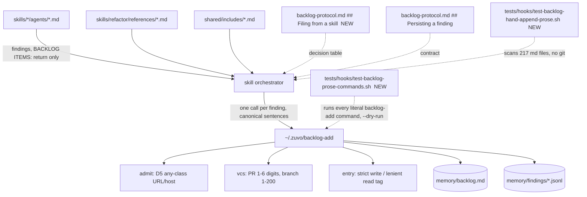

# Implementation Plan: Backlog noise bar, part 2 of 3: every skill files through `backlog-add`

**Spec:** inline, no spec
**spec_id:** none
**planning_mode:** inline
**source_of_truth:** inline brief (part 2 of the owner-approved 3-part design of 2026-10-13; started by the owner on 2026-10-15)
**plan_revision:** 8
**status:** Approved
**Created:** 2026-10-15
**Tasks:** 13
**Estimated complexity:** 7 complex, 6 standard
**Companion:** `docs/specs/2026-10-15-backlog-noise-bar-part2-inventory.md`, the per-site inventory (file, quote, verdict, caller, class, source). Tasks cite its batches.

## Context

| Part | Scope | State |
|------|-------|-------|
| 1 | `backlog-add`, the findings ledger, central policy prose, the production-path rule | shipped (v1.6.85, PR #77) |
| 2 | Rewire every skill/include/agent site that writes `memory/backlog.md` by hand; the prose guard; the intake's tag bounds; any-class URL targets | **this plan** |
| 3 | Read side: `findings query/mark/export/compact`, reader hooks, dup-map export | after part 2 |

**Why.** Part 1 built the one write path (bars, ledger, lock, dedupe), but the skills still tell agents to append rows by hand. A hand append skips every bar, so the intake keeps receiving the noise part 1 was meant to stop: 2,951 open zuvo entries retired on 2026-10-12, about 45% of new ones rejected.

**External contract** (tgm-caretaker intake, 2af315d): `[pr:N]` with N of 1–6 digits and no leading zero; `[branch:name]` of 1–200 characters, all in `[A-Za-z0-9._/-]` (`_` is inside the set). Part 1 enforces the charset only.

**Prose surface** (Architect, measured): ≈118 units to rewire in 44 files (28 SKILL.md, 10 includes, 5 `skills/refactor/references/*.md`, which the brief's globs missed, plus `content-expand` found by the plan reviewer), plus 2 agent files that must say "return, don't persist". 9 agent files already conform through `agent-preamble.md`; 9 skills already delegate to `drive-by-findings.md`.

**Task count (13; the >12 smell is justified here):** 8 are prose batches of one skill family each; they cannot merge further without crossing the 5-file boundary, and splitting into a second PR would leave main with skills contradicting the protocol (rule 17's harm, not its cure). Two code tasks (T1 tags, T2 D5) open; the guard (T3) and the prose-command test (T4) follow, so every batch is checked by both; T13 retires the temporary PENDING ratchet and runs the whole-repo proof on its own (cross-model: the riskiest closing step is not bundled with prose edits).

**Handed to part 3:** ledger records with a URL/host `target` have `files: []`; part 3's readers (dup-map, radar) key on `files[].path` and must skip them. Ledger status marking (`findings mark`) is part 3; part 2 prose never names it.

## Owner-level decisions

The owner approved the goal ("`memory/backlog.md` holds only work that becomes tickets; every finding is still kept as data"). These 7 decisions follow from it; they were taken by the orchestrator, checked by the Tech Lead, and are surfaced to the owner in the final summary:

| D | Decision |
|---|----------|
| D1 | Validity-gate items (`B-*-incomplete-<date>`, tier2-skip, escape-hatch), deferred decisions and follow-up work are `--class PROCESS --conf 90 --target subject:<skill>-<gate>`, **without a date**, so a repeat bumps one record (`LEDGER-BUMPED seen=N`). Ledger only. |
| D2 | review's localized-deferral drift gate accepts an F-id as well as a B-id. The field name `backlog_deferral` stays. |
| D3 | review's confidence scale follows the central bars: 0–25 is not passed to `backlog-add`; 26+ is. `[low-confidence]` / `[below-threshold]` are retired; the rescorer's column becomes `Disposition` (`DISCARD` / `RECORD` / `REPORT`). |
| D4 | A finding in a file the run is not editing is `--source drive-by:<skill>`; a finding in an edited file the run defers is `--source <skill>`. |
| D5 | A URL or host `--target` is accepted for every class; the bars still route (report-only classes → ledger). `subject:` stays restricted to PROCESS and SEC. `--missing-assertion` with `--target` is `bad-combination`. |
| D6 | review stops reading and editing `memory/backlog.md` as a commit queue in all four places: `tag`, `mark-reviewed`, the per-commit loop's "clean backlog", and `new` resolution step 1 (which today parses a finding line as a commit). `tag <queue-file>` ticks the batch queue file instead. |
| D7 | ship's "NIT → backlog or ignore, silently is fine" becomes a `backlog-add --class CQ --source ship` call (ledger). |

**Not changed (deliberate):** when an audit records. An audit that records only with `--persist-backlog` still does; one that records always still does. Part 2 changes the path, not the trigger.

## Architecture Summary

- `backlog-archive.py` and `zuvo_backlog_parse.py` are not edited. `hooks/backlog-hand-append-warn.sh` (the runtime net) is not touched; the guard is the prose net.
- The rule lives in ONE place: a new `## Filing from a skill` section in `backlog-protocol.md`, after `## Persisting a finding: backlog-add` and before `## Backlog Table Format`. A separate section because `test-backlog-add-contract.sh` parses tables inside "Persisting a finding" by header; the new table's header starts with `Situation`.
- `zuvo_backlog_vcs.py` (428 lines) and `zuvo_backlog_admit.py` (411) are already over the 300-line default: T1 and T2 change regexes and one predicate only, net growth ≤ 10 lines each.

## Technical Decisions

### TD1. Canonical sentences (each batch uses these verbatim, `<skill>` replaced)

Every sentence names `backlog-add` or `drive-by-findings.md`, so the guard's soft patterns exempt it by construction. **Each command is ONE backtick span**, so the prose-command test (T4) can run it.

1. **Generic write:** "Record it with `~/.zuvo/backlog-add --class <C> --conf <N> --source <skill> --file <path> --line <line> --anchor '<anchor>' --title '<title>'` (one call per finding; `backlog-protocol.md` "Persisting a finding"; `--anchor` is required for BUG, SEC, DATA). The helper decides whether it reaches `memory/backlog.md` or only the findings ledger; report the B- or F-id it prints. On a non-zero exit act on the protocol's exit table; a finding still not persisted is listed under `NOT PERSISTED (<reason>)`, never appended by hand."
2. **Adversarial boilerplate** (build, debug, receive-review, fix-tests, seo-fix, geo-fix, write-e2e, execute's variant):
   - "**WARNING**: fix if localized (< 10 lines). Otherwise record it with `~/.zuvo/backlog-add --class <C> --conf <N> --source <skill> --file <path> --line <line> --title '<title>'` (`backlog-protocol.md` "Persisting a finding")."
   - ""Pre-existing" is NOT a reason to skip a finding. If the issue is in a file you are already editing, fix it now. If not, record it with `~/.zuvo/backlog-add --class <C> --conf <N> --source drive-by:<skill> --file <path> --line <line> --title '<title>'` (`drive-by-findings.md`). The adversarial review found a real problem: don't dismiss it just because it existed before your changes."
3. **Process item (D1):** "Record it as a process item: `~/.zuvo/backlog-add --class PROCESS --conf 90 --source <skill> --target subject:<skill>-<gate> --title '<what was not done, and why>'` (`backlog-protocol.md` "Filing from a skill"). It is kept in the findings ledger, not ticketed; name its F-id in the report." A deferred decision uses `subject:<skill>-decision-<slug>`, the question as the title and both options in `--evidence`.
4. **Closing, not removing** (replaces "Remove row by fingerprint", "Delete resolved items", "Delete any open backlog items for Tier A files", "If yes, remove the line"). It states the skill's duty; it does not claim the helper refuses every fixed finding (only anchored classes are refused): "Do not call `backlog-add` for a finding this run fixed. An open backlog entry the run resolved is closed, never removed: tick it and append its resolution marker (`[FIXED <sha7>]`) as `backlog-protocol.md` "How to Persist Findings" step 3 says; the archive helper moves it ("Archiving is done by the helper, never by hand")." code-audit's Tier A rule becomes "A Tier A score does not prove any one defect is gone: close only an entry whose cited code this run re-read and found fixed."
5. **seo/geo/content fix tables** (`Finding status | Backlog action`): FIXED → "No record; close an open entry (sentence 4)". NEEDS_REVIEW / MANUAL / OUT_OF_SCOPE / NO_TEMPLATE → "Record (`backlog-add`; `--file` when a repo file causes it, `--target <url>` for a live page). The helper bumps a re-sighting." `category seo-manual` moves into `--fix 'manual: …'`. INSUFFICIENT DATA and ALREADY_APPLIED_BY_SEO_FIX keep "no action".
6. **review utility modes (D6):** `tag` → "No audit. `tag <queue-file>` ticks (`- [x]`) every queue entry whose commit is an ancestor of HEAD and prints `N ticked, M remaining`; without a file it prints usage and stops. It never edits `memory/backlog.md`, which holds findings, not commits." `mark-reviewed`: delete "After tagging, clean `memory/backlog.md`". Per-commit loop: delete "-> clean backlog". `new` resolution: delete step 1; order = newest `reviewed/*` tag on the branch → merge-base with the default branch → `HEAD~5` with a warning.
7. **Severity** (`severity-vocabulary.md`): "When persisting through `backlog-add`, pass the canonical level as `--severity`: S1 `critical`, S2 `high`, S3 `medium`, S4 `low`. Keep the skill's own label in the title or evidence when it matters." No STALE-* token (`test-backlog-grooming.sh:468`).
8. **Staging:** a committing skill stages exactly the `wrote=` paths. refactor `completion.md:9` becomes "Phase 4's run telemetry is local and never staged. The exception is the `wrote=` paths `backlog-add` prints: stage exactly those (`backlog-protocol.md`)."
9. **Report lines:** "Backlog: N items persisted" → "Recorded: N (backlog: a, ledger: b), plus each `NOT PERSISTED (…)` by name". execute's field keeps the name `backlog-adds` and its int/-1 contract; `session-state.md` redefines it as "findings this task kept through `backlog-add` (any verdict but REFUSED and DISCARDED)".
10. **The user's own add** (`skills/backlog/SKILL.md` "Adding Items", mode row `add`): one `backlog-add` call per item, `--source user`; BUG when the user states a wrong behaviour, else CQ; `--class PROCESS --target subject:<slug>` for an item with no file. `ZUVO_BACKLOG_ADMIT=1` only when the user invoked `zuvo:backlog add` themselves in this message, never when a skill or agent invokes it. The `B-{N}` minting ("Determine the next"), the lookup-then-append steps and `Source: manual` are deleted; the command placeholder `B-{N}` becomes `B-<id>`.

### TD2. Invalid sources

| Today | Becomes |
|---|---|
| `test-audit/{date}` | `test-audit` |
| `zuvo:refactor`, `zuvo:refactor/cq-auditor` (as a source) | `refactor` (the agent name goes in `--evidence`) |
| `Source: manual` | `user` |
| `debug/[date]` ("formerly") | `drive-by:debug`; the parenthetical is deleted |
| `source:build` (build §4.5 template) | `--source build`; the template is deleted |
| `--source pentest --dimension PT3` | `~/.zuvo/backlog-add --class SEC --conf <N> --source pentest --target <url> --evidence '<evidence>' --title 'PT3: <title>'` (one span) |

### TD3. The guard: `tests/hooks/test-backlog-hand-append-prose.sh`

Bash wrapper around a python3 stdlib heredoc (the `test-backlog-add-contract.sh` idiom: `ok`/`no` counters, `RESULT: PASS=n FAIL=m`, no SKIP path). Reads only `$ROOT` files: no git, no `~/.zuvo`, no network.

- **Usage:** `bash tests/hooks/test-backlog-hand-append-prose.sh [--only PATH ...]`. Self-test and mutants always run. Exit 0 = PASS, 1 = any FAIL. FAIL line: `FAIL <file>:<line> [<tier>:<pattern-name>] <unit text, cut at 140>`.
- **Scope:** `skills/*/SKILL.md`, `skills/*/agents/*.md`, `skills/*/references/*.md`, `shared/includes/*.md` (217 files on 9e510823).
- **Units:** split on blank lines, then at lines starting `-`, `*`, `N.` or `|`; join wrapped lines. A fenced code block is one unit. Strip balanced `"…"`/`“…”` spans **within one physical line and ≤ 80 characters**; keep backtick spans.
- **Tier A, hand-write mechanics** (exempt only by negation or allowlist, never by a citation): `B-\{N\}\s*\|`, `next .{0,10}B-\{N\}`, a line starting `- B-{N}`; a dated process id `B-[\w-]+-<date>` / `B-[\w-]+-YYYY-MM-DD`; `increment\s+[`*]*[Ss]een`; `Add as OPEN`; `Remove row by fingerprint`; `Delete (resolved items|any open backlog)`; `` memory/backlog\.md`?\. If missing, create ``; `(zuvo:|/)backlog add`.
- **Tier B, soft verbs** (exempt by a citation): a write verb (`persist|add|write|record|append|push|emit|clean|remove|drop|delete`) within 80 characters before `memory/backlog.md`; `(persist|add|write|record|push|go|route|defer|reach|stay)\w* … (to|in|into) (the )?backlog`; `backlog(s|ged)? (it|them|the \w+|each|with)`; `(→|->|\+) (per-file |per-module )?backlog`; `(add|record)\w* … backlog (item|entry)`; `and backlogged`; `backlog only if`; `and the backlog`; `\*\*Backlog( persistence)?:\*\*`; `(per-file|per-module|named) backlog (item|entry)`; `after backlog`; `` (push|emit|send)\w* .{0,40}`?zuvo:backlog ``. No `\| *backlog` (it hits table headers).
- **CQ14 check:** a table whose header row contains both `Verdict` and `Exit` outside `backlog-protocol.md` is flagged (`[B:restated-verdict-table]`), so no skill restates the contract.
- **Citation exemption (Tier B only):** `~/.zuvo/backlog-add`, `` `backlog-add` `` with `backlog-add\b(?!s)` (the field `backlog-adds` does not exempt), `drive-by-findings.md`, `Persisting a finding`, `Filing from a skill`.
- **Negation exemption:** a NEG word (`never|not|no|don't|nor|without|forbid|instead of|rather than`) within the 3 words before the match, except `if not` / `or not`.
- **Allowlist:** `(path, scope, key, reason)`; `scope` = `file` (only `backlog-protocol.md`, `backlog-grooming.md`, `backlog-verifier.md`), `section` (an exact heading: the backlog SKILL's resolving, schema, template, grooming and archive sections; never "Adding Items"), or `unit` (an exact substring for a proven false positive). No line numbers. **Rot rules:** a `file` key's file exists; a `section` heading exists and contains ≥ 1 flagged unit; a `unit` key matches **exactly one** unit, flagged without the key. Otherwise `FAIL stale allowlist key`.
- **RETIRED_QUOTES (permanent):** `{path: [quote, …]}`. Each batch task adds the quotes of its sites the patterns cannot see (GUARD_BLIND) and its D-decision absences (e.g. review's "clean `memory/backlog.md`", ship's "silently is fine", `[low-confidence]`, `--source pentest --dimension PT3`, "Persist findings per `backlog-protocol.md`"). A quote present in its file → `FAIL retired quote back in <file>`. A batch adds its entries in its RED step, before editing, so the full guard fails on them first and passes after GREEN; the entries are kept after PENDING is deleted.
- **PENDING ratchet (temporary; deleted in T13):** `{path: max_flagged_units}` from T3's RED run. Flagged > max → `FAIL new hand-write in a pending file`; flagged == 0 → `FAIL pending file is clean: remove it`. `--only` ignores PENDING for the named files (strict).
- **Checks:**
  - G1 anchors: `## Persisting a finding: backlog-add` contains "Never append a finding to `memory/backlog.md` by hand"; `## Filing from a skill` exists.
  - G2 self-test: named TP/TN fixture units, each named by the defect it catches. TPs include the wrapped "record it in\n `memory/backlog.md`", "If not, add it to backlog", "Persist to backlog if not fixed", a `B-{N} |` template + "(see `backlog-add`)", `B-review-incomplete-<date>`, the `backlog-adds` sentence, two adjacent list items where only the second cites `drive-by-findings.md`, `{"a": 1} persist to backlog {"b": 2}`, a `| Verdict | Exit |` header. TNs include "no cap, no backlog", "never backlog it", "Never a silent backlog row.", canonical sentences 1–4 verbatim, `'closes the "RECOMMENDED → backlog" reflex'`, `--source drive-by:<skill>`, `fix B-<id>`.
  - G2m mutants: every configured pattern has ≥ 1 TP fixture whose expected `[tier:pattern]` names it (`FAIL pattern without fixture`); the matrix removes each pattern in turn and expects its row to flip, printing `mutant <pattern> caught`; plus structural mutants (negation window unbounded, `(?!s)` dropped, paragraph-level split, quote stripping off, citation exemption on Tier A). The count of `caught` lines must equal patterns + structural mutants. A mutant that changes nothing is a FAIL.
  - G2t tree-path mutation (in process, no writes): append "If fix is larger, add to backlog with specific file:line." to the text of one real clean, non-allowlisted, non-PENDING file, scan it with the tree scan's own function, expect exactly one new flag naming that file; print `tree-mutation caught <file>`.
  - G3 floor: files scanned == the globs' expansion and ≥ 200; units ≥ 90% of the T3-measured count. With `--only`, each path must exist, be in scope and yield ≥ 1 unit.
  - G4 tree scan; G5 stale keys and RETIRED_QUOTES; G6 sources: inside units containing `backlog-add` or `zuvo:backlog add` only, every `--source[ =]'?<tok>` (`(?![-\w])`) matches `^(drive-by:)?[a-z0-9-]+$`, `user`, or a placeholder (`<skill>`, `drive-by:<skill>`, `<src>`); the context-anchored legacy tokens `--source zuvo:`, `` source: `?test-audit/ ``, ``Source: `manual` ``, `` formerly `debug/ `` are absent. G6 ignores the file allowlist and obeys PENDING.

### TD4. Tag bounds (T1)

- `vcs._PR_RE` → `[1-9][0-9]{0,5}`; `_CACHE_ROW_RE`'s PR group → the same; `_BRANCH_OK_RE` → `[A-Za-z0-9._/-]{1,200}`.
- Explicit 7-digit `--pr` / `ZUVO_BACKLOG_PR` → `REFUSED bad-pr`. A 201-character branch with no PR → `untaggable` (non-SEC → ledger `branch-untaggable`, SEC → lands untagged).
- `_own_pr`: gh's `number` matching `_PR_RE` → itself; matching `_PR_OVERSIZE_RE = [1-9][0-9]{6,}` → `""` (cached "no taggable PR": gh is asked once, not on every add; the tag becomes `[branch:]`, which the intake holds until merge); anything else → None (today's garbage path).
- `entry`: split `_TAG_RE` into `_TAG_WRITE_RE` (strict; only `_check_tag`, so `render` and `render_regression` refuse an out-of-contract tag) and `_TAG_READ_RE` (today's pattern, not widened; `_TAG_TAIL_RE` and `_OWN_RE`). Strict ⊂ lenient keeps the self-check round trip; lenient read keeps part 1's entries bumpable and re-openable.

## Quality Strategy

- **Framework:** stdlib `unittest` rows in the existing `tests/hooks/test_backlog_{vcs,entry,admit,add}.py` (run by `tests/hooks/test-backlog-add.sh`; baseline 169 tests, 62 s on the farm); bash+python3 heredoc tests picked up by `run-all.sh`'s `tests/hooks/test-*.sh` glob. Every row and fixture names the defect it catches. All runs through `rt --light`, bare (never `| tail`); the local machine blocks test runs.
- **Prose tasks** prove themselves with the guard: `--only <batch files>` exits 1 before the edit (artifact) and 0 after; the full guard exits 0 (which also proves PENDING lost the files and the RETIRED_QUOTES are absent); the batch's pinned-phrase suites stay green.
- **Pinned tokens beside rewired sentences stay byte-identical:** `no backlog` / `never backlog` (`tests/skill-suite/test-comment-pass-wiring.sh:133,185`), `backlog-adds` / `TT_BACKLOG_ADDS` (`tests/skill-suite/test-task-telemetry-contract.sh`), `fixed:2/backlog:4`, `backlogged:3` (`tests/hooks/test-refactor-safety-gate.sh:91-100`), `7/5:2-backlogged-out-of-fence` (`tests/hooks/test-refactor-v4-prove-gate.sh:120`), infra-audit's `backlog-protocol.md` load line (`tests/infra-suite/test-infra-skill-contract.sh:91`).
- **Locators:** line numbers in tasks are 9e510823 locators for orientation; the executor anchors every edit on the inventory's verbatim quote (and section heading), and edits a file bottom-up so earlier locators stay valid.
- **Serial batches are intentional:** T5–T12 share the guard's PENDING and RETIRED_QUOTES tables; serial edits keep the ratchet simple and conflict-free.
- **Codex build per batch:** every batch Verify runs `ZUVO_DIST_ROOT=$(mktemp -d) bash scripts/build-codex-skills.sh` (through `rt --light bash -c`), because the Codex build fails on Claude-Code tool names that `validate-skills.sh` does not check.
- **No live install from the branch:** nothing runs `./scripts/install.sh` from this worktree (it would overwrite `~/.claude`, `~/.codex`, `~/.zuvo` with unmerged code). CLI proofs use the worktree's `scripts/zuvo-home/backlog-add` or `install_zuvo_home` into a temp HOME; the Codex build check uses `ZUVO_DIST_ROOT=$(mktemp -d) bash scripts/build-codex-skills.sh`.

| Gate | Where |
|------|-------|
| CQ3 input validation (D5 widening, tag bounds) | T1, T2 |
| CQ5 credential check runs for newly admitted URL classes | T2 |
| CQ6 guard runtime (< 2 s, no per-file subprocess) | T3 |
| CQ8 exit-code handling: sentence 1 states the NOT PERSISTED rule, every batch cites it | T3, T5–T12 |
| CQ14 no restated verdict/exit tables outside the protocol | T3 |
| CQ19 contract: prose bounds equal regex bounds; C1–C4 green; every prose command accepted by the CLI | T1, T2, T4, T13 |
| CQ22 PR cache and `_own_pr` agree (gh-call counts) | T1 |

## Coverage Matrix

| Row ID | Authority item | Type | Primary task(s) | Notes |
|--------|----------------|------|-----------------|-------|
| G1 | every hand-write site is rewired to one `backlog-add` call per finding by the orchestrator | requirement | T5–T12, T13 (smoke) | inventory batches |
| G2 | sub-agents return findings, never persist | requirement | T6 (cq-auditor), T8 (confidence-rescorer) | |
| G3 | a guard in run-all, no `.git`, RED on today's tree, mutation-proven | requirement | T3, T13 | |
| G4 | tags within the intake contract | constraint | T1 | |
| G5 | any class may name a live URL/host (D5), routed by the bars | requirement | T2, T11 | |
| G6 | every `--source` in the prose is valid | constraint | T3, T6, T7, T9, T12 | guard G6 + T4 |
| G7 | resolved entries are closed and archived by the helper, never deleted by hand | requirement | T3, T8, T9, T10, T11 | sentence 4 |
| G8 | process items reach the ledger only, undated (D1) | requirement | T3 (dated-id pattern), T5, T7, T8, T10, T12 | |
| G9 | review no longer treats `memory/backlog.md` as a commit queue (D6) | requirement | T8 | RETIRED_QUOTES |
| G10 | zero silent discards above 25% (D3, D7) | requirement | T8 | |
| G11 | the literal `backlog-add` commands in the prose parse and are accepted by the CLI | requirement | T4, T13 | prose-command test |
| G12 | no regression in existing suites | constraint | T1–T13 | run-all in T13 |
| G13 | review's drift gate accepts an F-id (D2) | requirement | T8 | |
| G14 | in-fence deferrals use `<skill>`, out-of-fence findings `drive-by:<skill>` (D4) | requirement | T7, T8, T9 | |
| G15 | the user's own add path: `--source user`, `ZUVO_BACKLOG_ADMIT=1` only on the user's own invocation (TD1.10) | requirement | T3 | |
| S1 | scope: no part 3 read side; `backlog-archive.py` and `zuvo_backlog_parse.py` unchanged; audit triggers unchanged | scope | T13 | `git diff --quiet` |

## Review Trail
- Phase 1: full fan-out. Architect, Tech Lead and QA Engineer ran on Opus, sequentially. Reports: `zuvo/context/plan-{architect,techlead,qa}.md`. QA's hardening (two-way reconciliation, pattern-deletion mutants, tree-path mutation, `--only` floor, exact-one allowlist keys, PENDING ratchet, line-local quote strip, narrowed `B-{N}`, context-anchored G6, sentence 4 reworded, prose smoke) is adopted in TD1/TD3 and T4 (the prose smoke, originally planned last).
- Plan reviewer: revision 1 → ISSUES FOUND (1 CRITICAL: `feat/x_y` row contradicted the contract — `_` is in the set; 11 WARNING: pin rows claimed to fail at base, T1 bundled two changes, deps missing concrete reads of T2/T1, content-expand missing from the inventory, absence checks without commands, T2(c)/(d) not commands, SMOKE1 step 4 unauthored, T11 extraction gaps, `install.sh` from a worktree, a rebase step, D2/D4/TD1.10 uncovered; 4 INFO) → all fixed in revision 2: row corrected (`feat/x+y` untaggable, `feat/x_y` tagged), RED rows split into new-behaviour vs pin groups, T1 split into T1 (tags) + T2 (D5), dependencies list every concrete read, content-expand added to T10 and the inventory, `RETIRED_QUOTES` in the guard replaces artifact-only absence checks, T3's proofs read G2m/G2t output, SMOKE1 step 4 authored in T12, sentences 1–3 made one span each with a full placeholder table, install replaced by temp-HOME/temp-DIST builds, the rebase step dropped, G13–G15 added, `test-python-lint.sh` used for ruff/mypy, CQ14 check added to TD3, part 3 hand-off line added, extra contract suites added to T6/T10/T11.
- Plan reviewer: revision 2 → ISSUES FOUND (0 CRITICAL, 4 WARNING: "Phase 4.4" and `--dimension` RETIRED_QUOTES would match correct text; two T2 "new behaviour" rows already pass at base; T11 missed its D5 dependency; 4 INFO) → all fixed in revision 3 as recommended (full-quote retirements, rows moved to Pins, `Dependencies: 2, 3, 10`, content-expand/T3 wording, the base-module proof command named, `test-review-patch-callsites.sh` in T6/T8/T10, G8 in T7's proof, a D4 awk in T8). Literal edits only, so per the stop rule no further reviewer pass.
- Plan reviewer: revision 3 → ISSUES FOUND (1 WARNING: the base-module proof relied on `PYTHONPATH`, which the tests' own `sys.path.insert` overrides; 1 INFO: TD3 still showed the bare `--dimension`) → fixed in revision 4 exactly as recommended (base-swap copy of the tree; full quote in TD3). Reviewer iteration cap (3) reached; literal edits applied verbatim from the reviewer's fix text.
- Cross-model validation (revision 3; 2 chunks, both ok; chunk 1 partial 2/4 providers: openrouter-3 and qwen timed out; chunk 2 4/4): 22 findings (1 CRITICAL, 15 WARNING, 6 INFO). Fixed in revision 5:
  - the prose-command test moved from last to T4 and runs in every batch's Verify (CRITICAL `complex-uncertain-scheduled-last`, `missing-spike`, `guard-vacuous-ordering`, `verify-only-by-prose-guard`, `full-cutover-deferred-to-final-task`);
  - its run check asserts exit 0 and an ACCEPTED/LEDGER/DISCARDED verdict (`run-check-weak-assertion`); it extracts `backlog-add` with any path prefix (`extractor-misses-nonbacktick-forms`); floors are exact counts recorded per batch (`floors-pinned-late`); the flow check asserts exact verdict prefixes (`task-12-vague-verification-verdict`);
  - RETIRED_QUOTES are added in each batch's RED, so content-expand has a real RED (`content-expand-no-red`, `guard-writes-without-same-task-test`);
  - T3's proof states the tolerated PENDING total (`green-guard-expected-with-pending`); cq-auditor's DEFERRED line format and the orchestrator's `--source refactor` instruction are asserted (`refactor-deferred-format-unverified`); sentence 1 states NOT PERSISTED, never a hand append (`no-error-path-tasks`);
  - the base-module proof was already replaced in revision 4 (`acceptance-proof-shadow-fragile`).
  Rejected: `guard-unbounded-single-task` (the guard's G1 asserts the section it ships with; the protocol part is one section; splitting adds a task, not separation); `serialized-chain-conflict` (one PENDING table keeps the ratchet simple; execute runs tasks sequentially anyway); `four-files-three-skills` (4 prose files, already complex/deep tier); `task-12-prose-command-execution-coverage` (spans without `--class` are partial mentions, flag-checked by design, and the test counts both kinds); `task-11-pending-proof-source-only` (G3's file and unit floors already prove the full scope is scanned); `standard-task-bloat` (one-sentence swaps per file; size justified per task); `pending-delete-ordering` (G2t's tree mutation runs on every guard run, PENDING or not); `complex-task-mixed-concerns` (the whole-repo checks moved into T12's Verify, the new test is its own task T4).
- Plan reviewer: revision 5 → ISSUES FOUND (0 CRITICAL, 3 WARNING: T4's exit-0 run check would refuse today's literal-file spans in backlog-protocol.md:66 / drive-by-findings.md:69; interim floors needed an undeclared file edit; T6's DEFERRED format pinned cq-auditor's drift instead of the preamble's format; 4 INFO: wrap-fragile awk, incomplete pentest span, leftover wording, T12 surface) → fixed in revision 6 exactly as recommended (literal-file seeding + `ZUVO_PR_LOOKUP=0`; `>=` interim floors, exact at T12; preamble `[CQ] conf:` format with a heading-bounded awk; one-line DEFERRED instruction; full pentest span; wording; T12 `integration` with an 8-file justification). Literal edits, no further reviewer pass.
- Cross-model validation (revision 5; `--exclude-last codex-5.3`; 2 chunks ok; chunk 1 partial: qwen timed out): 19 findings (2 CRITICAL, 13 WARNING, 4 INFO). Already fixed in revision 6: T5 RED, interim floors and the qwen CRITICAL on prose-command test ownership (floors are `>=` until T13), DEFERRED line check. Fixed in revision 7: T12 split into T12 (6 skills) and T13 (PENDING removal + exact floors + whole-repo green; qwen CRITICAL `risky-guard-deletion-scheduled-last`, `bloat-mislabeled-standard`); T4 RED made concrete against a stub checker; the cq-auditor quote retired as its full `--source` span; the `drive-by:refactor` line checked; T1/T2 prose bound phrases asserted; content-expand "6 PENDING files"; every proof's awk written out; T10's flag-row check against the merge-base; the Codex temp-DIST build in every batch; write-tests fetch/diff/merge step; line-number locators anchored on quotes; run-all id taken from rt's output with a stated summary.
  Rejected: `serial-chain-via-guard` (intentional; stated in Quality Strategy); `no-failure-path-for-helper-dependency` (sentence 1 carries the NOT PERSISTED rule since revision 5; the CLI's exit paths are tested by part 1's 169 tests).
- Plan reviewer: revision 7 → ISSUES FOUND (0 CRITICAL, 5 WARNING: base copies under ignored `zuvo/` never reach the farm; T2 reused T1's base dir; T7's `backlog-adds`/`-1` awk matched no line; T8's awk required three steps on one line; T4 still named T12; 2 INFO: T10's flag-row diff empty for 4 files, T12's G6 had no own assertion) → fixed in revision 8 exactly as recommended. Literal edits to proof commands only; per the stop rule (one re-review after an adversarial-driven revision, now spent) no further pass. Status: Reviewed.
- Status gate: Approved — the owner approved the 3-part design on 2026-10-13 ("okay lec") and started part 2 on 2026-10-15 ("kontynuuj"); D1–D7 are surfaced in the run summary for the owner to overrule.

## Task Breakdown

### Task 1: Tags stay inside the intake contract
**Files:** `scripts/zuvo-home/zuvo_backlog_vcs.py`, `scripts/zuvo-home/zuvo_backlog_entry.py`, `shared/includes/backlog-protocol.md` (the tag paragraph, the `--pr` argument row, the `bad-pr` refusal row). Tests (rows only): `tests/hooks/test_backlog_{vcs,entry,add}.py`.
**Surface:** backend-logic
**Complexity:** complex
**Dependencies:** none
**Failure:** halt
**Execution routing:** deep implementation tier

Gap today: `_PR_RE = [1-9][0-9]{0,8}`, `_BRANCH_OK_RE = [A-Za-z0-9._/-]+` (vcs l.51-52), `_CACHE_ROW_RE` PR group `{0,8}` (l.63), `entry._TAG_RE` (l.49) shared by write and read.

- [ ] RED — **new behaviour** (each must fail on 9e510823): `--pr 1000000` → ValueError, and via `test_backlog_add.py` `REFUSED bad-pr` exit 3; `ZUVO_BACKLOG_PR=1234567` → ValueError naming the env var; a 201-char branch, no PR → untaggable (CLI: BUG → `LEDGER … reason=branch-untaggable`, SEC → `ACCEPTED`, no tag); gh answers 1234567, resolved twice → `[branch:feat/x]` both times with **1** gh call (row in `test_no_pr_answer_is_cached_as_a_miss`); a cache row `\t1234567` written by the old rule → skipped and re-asked, 2 calls (row in `test_tampered_cached_pr_is_asked_again`); `render(tag="[pr:1234567]")` and `render_regression(…)` raise.
- [ ] RED — **pins** (pass before and after; they stop the rewrite overshooting): `--pr 999999` → `[pr:999999]`; `--pr 1` → `[pr:1]`; `--pr 0` and `--pr 012345` refused; a 200-char branch → `[branch:…]`; a 201-char branch + `--pr 12` → `[pr:12]`; `feat/x_y` → `[branch:feat/x_y]` (`_` is in the contract); `feat/x+y` → untaggable; gh answers 0 → re-asked (garbage stays None); `render` with a 200-char branch tag passes `self_check`; `parse_own` reads a line ending `[pr:1234567]` and a bump keeps the tag verbatim; `render_regression` of an archived line with tail `[pr:1234567]` strips it and appends the new tag.
- [ ] GREEN: TD4 exactly. Prose: the tag paragraph gets "1–6 digits, no leading zero; a branch name of 1–200 characters"; the `--pr N` row "(1–6 digits)"; the `bad-pr` row "a PR number of 1–6 digits". No `iter_entries` call, no `RC_` name, net growth ≤ 10 lines per module.
- [ ] Verify: `rt --light bash tests/hooks/test-backlog-add.sh && rt --light bash tests/hooks/test-backlog-add-contract.sh && rt --light bash tests/hooks/test-backlog-add-e2e.sh && rt --light bash tests/hooks/test-backlog-headings.sh && rt --light bash tests/hooks/test-backlog-grooming.sh && rt --light bash tests/hooks/test-python-lint.sh && awk '/1–6 digits/{a=1} /1–200 characters/{b=1} END{exit !(a&&b)}' shared/includes/backlog-protocol.md`
  Expected: every command exits 0.
- [ ] Acceptance Proof:
  - G4:
    - Surface: backend-logic
    - Proof: `rt --light bash -c 'python3 -m unittest -v tests/hooks/test_backlog_vcs.py tests/hooks/test_backlog_entry.py tests/hooks/test_backlog_add.py'`; then locally `mkdir -p .base-9e510823-t1 && git show 9e510823:scripts/zuvo-home/zuvo_backlog_vcs.py > .base-9e510823-t1/zuvo_backlog_vcs.py && git show 9e510823:scripts/zuvo-home/zuvo_backlog_entry.py > .base-9e510823-t1/zuvo_backlog_entry.py` and run the tests on a copy of the tree with the base modules swapped in (the tests derive ROOT from `__file__` and insert `scripts/zuvo-home` first, so `PYTHONPATH` cannot shadow them): `rt --light bash -c 'B=$(mktemp -d) && cp -R . "$B" && cp .base-9e510823-t1/*.py "$B/scripts/zuvo-home/" && cd "$B" && python3 -m unittest -v tests/hooks/test_backlog_vcs.py tests/hooks/test_backlog_entry.py tests/hooks/test_backlog_add.py'` (`.base-9e510823-t1/` is untracked but not ignored, so `rt` ships it; it is never staged and is deleted after the proof)
    - Expected: exit 0 on the branch with every new row named in `-v` output; exit 1 at 9e510823 with exactly the new-behaviour rows failing
    - Artifact: `zuvo/proofs/task-1-report.md`
- [ ] Commit: `backlog-add: PR and branch tags stay inside the intake contract`

### Task 2: Any finding may name a live URL or host
**Files:** `scripts/zuvo-home/zuvo_backlog_admit.py`, `shared/includes/backlog-protocol.md` (the `--target` argument row, the `bad-combination` refusal row), `shared/includes/agent-preamble.md` (the "a `target` is only for SEC and BUG" sentence). Tests (rows only): `tests/hooks/test_backlog_{admit,add}.py`.
**Surface:** backend-logic
**Complexity:** standard
**Dependencies:** 1
**Failure:** halt
**Execution routing:** default implementation tier

Gap today: `admit._TARGET_CLASSES` (l.85) restricts URL/host to SEC/BUG/DATA, so a live-page SEO/a11y finding cannot be kept at all. Depends on T1 because both edit `backlog-protocol.md`'s argument and refusal tables (rule 13).

- [ ] RED — **new behaviour** (each must fail on 9e510823): rename the flipped row `test_backlog_admit.py:282`; CQ URL → ledger `class-report-only`; ADVISORY host → ledger `advisory`; READ URL without evidence → `missing-field:evidence`; CLI: CQ `--target https://…` prints `LEDGER F-… reason=class-report-only` and leaves `memory/backlog.md` byte-identical; `ZUVO_BACKLOG_ADMIT=1` with the same call → `ACCEPTED`, and `parse_own` reads the written line. **Pins** (pass before and after): `subject:` with BUG and with CQ → `bad-combination`; TEST-GAP URL + `missing_assertion` → `bad-combination` (refused today by the target rule, after the widening by the new combination rule); CQ URL with `user:pw@` → `secret-like-value` (`_check_secrets` runs first).
- [ ] GREEN: `_TARGET_CLASSES` url/host → `CLASSES`; `--missing-assertion` + target → `bad-combination` in `_check_combination`; the `--target` and `bad-combination` rows state D5; agent-preamble says any class may name a live URL or host, `subject:` only PROCESS and SEC.
- [ ] Verify: `rt --light bash tests/hooks/test-backlog-add.sh && rt --light bash tests/hooks/test-backlog-add-contract.sh && rt --light bash tests/hooks/test-python-lint.sh && ! awk '/target. is only for .SEC. and .BUG./{f=1} END{exit !f}' shared/includes/agent-preamble.md && awk '/any class/ && /live URL or host/{f=1} END{exit !f}' shared/includes/agent-preamble.md`
  Expected: every command exits 0.
- [ ] Acceptance Proof:
  - G5:
    - Surface: backend-logic
    - Proof: `rt --light bash -c 'python3 -m unittest -v tests/hooks/test_backlog_admit.py tests/hooks/test_backlog_add.py'`; the same base-swap run as T1 with only `zuvo_backlog_admit.py` from 9e510823 extracted into its own untracked, non-ignored `.base-9e510823-t2/` (never T1's directory, whose base vcs/entry would fail T1's rows) and `tests/hooks/test_backlog_admit.py tests/hooks/test_backlog_add.py` as the modules under test
    - Expected: exit 0 on the branch; exit 1 at 9e510823 with exactly the new-behaviour rows failing
    - Artifact: `zuvo/proofs/task-2-report.md`
- [ ] Commit: `backlog-add: a live-page finding of any class is kept, and the bars still route it`

### Task 3: The filing rules, the user's add path and the prose guard
**Files:** `shared/includes/backlog-protocol.md` (new `## Filing from a skill`), `skills/backlog/SKILL.md` ("Adding Items", the `add` mode row, `Source: manual`, placeholder `B-{N}` → `B-<id>`), new `tests/hooks/test-backlog-hand-append-prose.sh`
**Surface:** config
**Complexity:** complex
**Dependencies:** 1, 2
**Failure:** halt
**Execution routing:** deep implementation tier

Gap today: no test reads the prose for hand appends; the protocol has no per-situation table; the backlog skill's `add` mints `B-{N}` and appends by hand. Depends on T1/T2: the section states their bounds and D5, and edits the same file.

- [ ] RED: write the guard (TD3) with an EMPTY PENDING and run it on the post-T2 tree: exit 1. Save the FAIL list, the per-file counts and the two-way reconciliation against the inventory: every flagged file is in a task's file list or gets a `unit` allowlist entry with a reason; every inventory WRITE/WRITE*/POLICY site is flagged or listed as GUARD_BLIND with its owning task (each owning task adds it to RETIRED_QUOTES). A flagged file in no task is a plan gap: stop and report it. A GUARD_BLIND quote is added to RETIRED_QUOTES by its owning task, never by T3 (it would fail T3's own full run). G2, G2m and G2t must pass before any tree result counts.
- [ ] GREEN: `## Filing from a skill` after `## Persisting a finding: backlog-add`: a `Situation | Class | Source | Location` table holding D1, D4, D5, D7, TD2's source map, the closing rule (sentence 4) and the staging rule (sentence 8), with canonical sentences 1–4 as the text skills cite. The backlog skill's add path per sentence 10. Fill PENDING with the T5–T12 files and their RED counts; record the total PENDING unit count in the proof. Measure the guard's runtime (< 2 s) and pin G3's unit floor at 90% of the measured count.
- [ ] Verify: `rt --light bash tests/hooks/test-backlog-hand-append-prose.sh && rt --light bash tests/hooks/test-backlog-hand-append-prose.sh --only shared/includes/backlog-protocol.md skills/backlog/SKILL.md && rt --light bash tests/hooks/test-backlog-add-contract.sh && rt --light bash tests/hooks/test-backlog-archive-dedup.sh && rt --light bash tests/hooks/test-backlog-headings.sh && rt --light bash tests/hooks/test-backlog-grooming.sh && rt --light bash tests/hooks/test-backlog-hand-append-warn.sh && rt --light bash scripts/validate-skills.sh`
  Expected: every command exits 0.
- [ ] Acceptance Proof:
  - G3, G6, G7, G8, G15:
    - Surface: config
    - Proof: (a) the RED run (empty PENDING) on the post-T2 tree; (b) the green full run, capturing its output; (c) in that output, one `mutant <pattern> caught` line per configured pattern plus the structural mutants, and one `tree-mutation caught <file>` line; (d) `awk` on `skills/backlog/SKILL.md`: section "Adding Items" contains `--source user` and `ZUVO_BACKLOG_ADMIT=1`, and no "Determine the next"
    - Expected: (a) exit 1, reconciliation complete, GUARD_BLIND listed by owner; (b) exit 0 with the stated PENDING total tolerated; (c) caught-line count == pattern count + structural mutants; (d) exit 0
    - Artifact: `zuvo/proofs/task-3-report.md` (with `task-3-guard-red.txt` linked)
- [ ] Commit: `backlog: one table says how a skill files a finding, and a guard fails any skill that appends by hand`

### Task 4: Every literal `backlog-add` command in the prose is run against the real CLI
**Files:** new `tests/hooks/test-backlog-prose-commands.sh`
**Surface:** integration
**Complexity:** complex
**Dependencies:** 1, 2, 3
**Failure:** halt
**Execution routing:** deep implementation tier

Gap: nothing checks that the commands the skills print exist as the CLI defines them (an invented flag such as `--dimension` exits 2 only at runtime). Placed right after the guard (cross-model: the riskiest check must not come last), so every prose batch runs it in its Verify and a wrong command fails in the batch that wrote it. Reads T1/T2's CLI and T3's scope and canonical sentences.

- [ ] RED: write the self-check assertions first, against a checker stub that reports nothing; the run exits 1 because no bad span below is reported with its fixture file:line and no good span's expected verdict appears. Fixture spans: `~/.zuvo/backlog-add … --dimension PT3` → unknown flag; `… --source zuvo:refactor` → `bad-source`; `scripts/zuvo-home/backlog-add --class CQ …` (a non-`~/.zuvo` prefix) → extracted; `--target subject:<skill>-<gate>` → substituted, not `bad-target`; a BUG span with `--anchor '<anchor>'` → exit 0 against the seeded file.
- [ ] GREEN:
  - Install `~/.zuvo` into a temp HOME with the real `install_zuvo_home` (the `test-backlog-add-e2e.sh` pattern).
  - Extract every backtick span and fenced block in the guard's scope that contains the token `backlog-add` followed by at least one `--flag` (any path prefix: `~/.zuvo/`, `scripts/zuvo-home/`, none); join `\` continuations; split with `shlex`. A bare name ("`backlog-add`") with no flag is a mention, not a command, and is skipped.
  - Flag check (every span): each `--flag` is in the CLI parser's option set (read from `zuvo_backlog_add` as the contract test does; `allow_abbrev=False`).
  - Run check (every span with `--class`): substitute from one table — `<skill>` → the owning skill directory, or for `shared/includes/<name>.md` the basename `<name>`; `<C>` → CQ; `<N>` → 60; `<gate>` → `gate`; `<slug>` → `slug`; `<path>`/`<line>`/`<anchor>` → a seeded file in a fresh temp git repo that contains the anchor at that line; a span's own literal `--file`/`--line`/`--anchor` and each `--also PATH:LINE` (e.g. `backlog-protocol.md:66` `src/cart.ts:42`, `drive-by-findings.md:69` `src/orders/totals.ts:40`) are seeded the same way — the anchor text at that line, or a filler line when there is no anchor; every span runs with `ZUVO_PR_LOOKUP=0`; `<url>` → `https://example.test/p`; `<title>`/`<evidence>`/`<fix>` → fixed text; `"$PWD"` → the temp repo; any other `$VAR` → a fixed value. Run with `--dry-run --json`. **Assert exit 0** and a verdict in {`ACCEPTED`, `LEDGER`, `DISCARDED`}; any other exit or verdict fails with the span's file:line. A span whose literal class/flags are legitimately refused must not exist in the prose.
  - Spans without `--class` (partial mentions such as `--source drive-by:<skill>`) get the flag check only; the test prints how many of each kind it saw.
  - Flow check: in a temp repo on branch `feat/x` with `ZUVO_PR_LOOKUP=0`, run for real (no `--dry-run`) three canonical-sentence commands from `backlog-protocol.md` "Filing from a skill" (a BUG with an anchor at conf 85, a CQ at conf 90, the PROCESS `subject:review-incomplete` twice): assert the exact verdict prefixes `ACCEPTED backlog B-` with the line ending `[branch:feat/x]`; `LEDGER F-` with `reason=class-report-only` and `memory/backlog.md` byte-identical; `LEDGER F-` then `LEDGER-BUMPED` with `seen=2`. T13 re-points the flow at the commands in code-audit and review.
  - Floors: record the exact span and executed-command counts in the artifact; the test asserts `>=` those T4 counts (interim batches add commands without editing this file); T13 pins the final counts exactly.
- [ ] Verify: `rt --light bash tests/hooks/test-backlog-prose-commands.sh && rt --light bash tests/hooks/test-backlog-hand-append-prose.sh`
  Expected: both exit 0; the prose test prints its span and command counts.
- [ ] Acceptance Proof:
  - G11:
    - Surface: integration
    - Proof: the Verify run; plus the RED fixture run before the checks existed
    - Expected: RED exits 1 naming the fixture rows; GREEN exits 0 with the counts recorded
    - Artifact: `zuvo/proofs/task-4-report.md`
- [ ] Commit: `tests: every backlog-add command the skills print is run against the real CLI`

### Task 5: Shared includes file through `backlog-add`
**Files:** `shared/includes/{severity-vocabulary,quality-gates,no-pause-protocol,followup-ideas,test-quality-gate,test-bugfix-protocol,test-blocklist,test-code-types-core,blind-coverage-audit}.md`, the guard (PENDING, RETIRED_QUOTES)
**Surface:** docs
**Complexity:** standard
**Dependencies:** 3, 4
**Failure:** halt
**Execution routing:** default implementation tier

9 files, justified: 13 one-sentence swaps in one family of includes, no tables or logic. Inventory batches 1 (minus the backlog skill) and 2.

- [ ] RED: docs-only; add this batch's RETIRED_QUOTES entries (its GUARD_BLIND quotes from T3's proof, if any) first; `bash tests/hooks/test-backlog-hand-append-prose.sh --only <the 9 files>` exits 1 listing their units.
- [ ] GREEN: sentence 7 for severity-vocabulary; sentence 1 for quality-gates, test-quality-gate (TEST-GAP/CQ; `--missing-assertion` for a named missing assertion), test-blocklist, blind-coverage-audit; sentence 3 for no-pause-protocol (decision), test-bugfix-protocol l.24 (declined), test-code-types-core (`subject:write-tests-type-tests-not-enforced`); POLICY wording for followup-ideas and test-bugfix-protocol l.53. Add this batch's GUARD_BLIND quotes to RETIRED_QUOTES; remove the 9 files from PENDING.
- [ ] Verify: `rt --light bash tests/hooks/test-backlog-hand-append-prose.sh --only shared/includes/{severity-vocabulary,quality-gates,no-pause-protocol,followup-ideas,test-quality-gate,test-bugfix-protocol,test-blocklist,test-code-types-core,blind-coverage-audit}.md && rt --light bash tests/hooks/test-backlog-hand-append-prose.sh && rt --light bash tests/hooks/test-backlog-grooming.sh && rt --light bash tests/infra-suite/test-infra-wiring.sh && rt --light bash tests/hooks/test-backlog-prose-commands.sh && rt --light bash -c 'ZUVO_DIST_ROOT=$(mktemp -d) bash scripts/build-codex-skills.sh' && rt --light bash scripts/validate-skills.sh`
  Expected: every command exits 0.
- [ ] Acceptance Proof:
  - G1, G8:
    - Surface: docs
    - Proof: the `--only` run on the pre-edit files and on the edited files
    - Expected: exit 1 before, exit 0 after; the full run exits 0 (RETIRED_QUOTES absent)
    - Artifact: `zuvo/proofs/task-5-report.md`
- [ ] Commit: `includes: every shared rule that kept a finding now hands it to backlog-add`

### Task 6: The refactor family files through `backlog-add`
**Files:** `shared/includes/refactor-reference.md`, `skills/refactor/references/{completion,remediation,review,transformation,planning}.md`, `skills/refactor/agents/cq-auditor.md`, the guard (PENDING, RETIRED_QUOTES)
**Surface:** docs
**Complexity:** complex
**Dependencies:** 3, 4, 5
**Failure:** halt
**Execution routing:** deep implementation tier

7 files, justified: one skill whose SKILL.md is split across references; a partial rewire leaves refactor contradicting itself. Inventory batches 3 and 4 (refactor rows). Depends on 3 (the guard and the section it cites), 4 (the prose-command test in its Verify) and 5 (the guard file, serialized).

- [ ] RED: add this batch's RETIRED_QUOTES entries (listed in GREEN) to the guard first; `--only <the 7 files>` exits 1 and the full guard fails on those quotes.
- [ ] GREEN: sentence 1 (`--source refactor`) for completion l.69-71 (drops the `file|rule-id|signature` fingerprint and both invalid sources), remediation l.20-21/91/133/145/159/223, review l.189, transformation l.169, planning l.120/146, refactor-reference l.371/435; sentence 3 for declined decisions; sentence 8 for completion l.9. cq-auditor: DEFER items move to a `### DEFERRED` section in `agent-preamble.md`'s line format (`- [CQ] conf: NN | file_path:line | anchor: … | evidence: … | severity: <…> | <defect>`, with one `- [CQ] conf: 80 | …` example line; the old `- [severity] file:line — description (confidence: N%)` drift is retired), class CQ (BUG only when it names input → wrong output); `BACKLOG ITEMS` stays drive-by only; the orchestrator files DEFERRED with `--source refactor`, BACKLOG ITEMS with `drive-by:refactor`; completion.md states each on one physical line: `` `DEFERRED` items: `~/.zuvo/backlog-add … --source refactor …` `` and `` `BACKLOG ITEMS`: `~/.zuvo/backlog-add … --source drive-by:refactor …` ``. Pinned tokens stay byte-identical. RETIRED_QUOTES: "per-file backlog entry naming each", "**Backlog:** Persist ONLY", `--source zuvo:refactor/cq-auditor` (the full span: the agent name may legitimately appear in `--evidence`). Remove the 7 files from PENDING.
- [ ] Verify: `rt --light bash tests/hooks/test-backlog-hand-append-prose.sh --only shared/includes/refactor-reference.md skills/refactor/references/{completion,remediation,review,transformation,planning}.md skills/refactor/agents/cq-auditor.md && rt --light bash tests/hooks/test-backlog-hand-append-prose.sh && rt --light bash tests/hooks/test-refactor-safety-gate.sh && rt --light bash tests/hooks/test-refactor-v4-prove-gate.sh && rt --light bash tests/hooks/test-refactor-contract.sh && rt --light bash tests/skill-suite/test-comment-pass-wiring.sh && rt --light bash tests/hooks/test-backlog-prose-commands.sh && rt --light bash -c 'ZUVO_DIST_ROOT=$(mktemp -d) bash scripts/build-codex-skills.sh' && rt --light bash scripts/validate-skills.sh && awk '/^### DEFERRED/{f=1} END{exit !f}' skills/refactor/agents/cq-auditor.md && awk '/^### DEFERRED/{d=1;next} /^### /{d=0} d && /^- \[CQ\] conf: [0-9]+ \| /{f=1} END{exit !f}' skills/refactor/agents/cq-auditor.md && awk '/^`DEFERRED` items: `~\/\.zuvo\/backlog-add .*--source refactor/{f=1} END{exit !f}' skills/refactor/references/completion.md && awk '/^`BACKLOG ITEMS`: `~\/\.zuvo\/backlog-add .*--source drive-by:refactor/{f=1} END{exit !f}' skills/refactor/references/completion.md`
  Expected: every command exits 0.
- [ ] Acceptance Proof:
  - G1, G2, G6:
    - Surface: docs
    - Proof: `--only` before and after; the full run
    - Expected: exit 1 before, exit 0 after; full run exits 0 with this batch's RETIRED_QUOTES absent
    - Artifact: `zuvo/proofs/task-6-report.md`
- [ ] Commit: `refactor: deferred and out-of-fence findings go through backlog-add; the auditor returns them`

### Task 7: build, execute and debug file through `backlog-add`
**Files:** `skills/{build,execute,debug}/SKILL.md`, `shared/includes/session-state.md` (the `backlog-adds` description only), the guard (PENDING, RETIRED_QUOTES)
**Surface:** docs
**Complexity:** complex
**Dependencies:** 3, 4, 6
**Failure:** halt
**Execution routing:** deep implementation tier

Inventory batch 5. Gap: build §4.5's hand template (`- B-{N} | …`, "increment `seen:N`", a stale "Phase 4.4"), execute §Backlog Persistence (own fingerprint, dedupe and confidence routing), debug's legacy source.

- [ ] RED: add this batch's RETIRED_QUOTES entries (listed in GREEN) to the guard first; `--only <the 4 files>` exits 1 and the full guard fails on those quotes.
- [ ] GREEN: build: delete the §4.5 template; sentence 1 for DEFER and §4.5; sentence 2 for the adversarial lines (D4 sources); sentence 3 for the user question (l.408) and the blocked dependency (l.443); the auditor prompt's "DEFER (backlog)" → "DEFER (returned)"; "Phase 4.4" → 4.5; report lines per sentence 9. execute: §Backlog Persistence → sentence 1 by reference (the bands are the protocol's, not restated); l.402/543-544/685/722 → sentence 3; l.718/805/812 → sentence 1 or 2 (D4); l.824's loop fingerprint stays a loop-local key and stops citing "Backlog Persistence"; `backlog-adds` name and type stay. debug: sentence 2; l.488-497 → `drive-by:debug`, the "formerly" parenthetical deleted. session-state: sentence 9's definition. RETIRED_QUOTES: "Persist to backlog in Phase 4.4" (the full quote: `### 4.4 Adversarial Review` and l.814's "Phase 4.4" are correct references), "0-25 discard, 26-50 backlog only", `debug/[date]`. Remove the 4 files from PENDING.
- [ ] Verify: `rt --light bash tests/hooks/test-backlog-hand-append-prose.sh --only skills/{build,execute,debug}/SKILL.md shared/includes/session-state.md && rt --light bash tests/hooks/test-backlog-hand-append-prose.sh && rt --light bash tests/skill-suite/test-task-telemetry-contract.sh && rt --light bash tests/skill-suite/test-comment-pass-wiring.sh && rt --light bash tests/skill-suite/test-verdict-recording-wiring.sh && rt --light bash tests/hooks/test-log-drive-by.sh && rt --light bash tests/hooks/test-review-patch-callsites.sh && rt --light bash tests/hooks/test-backlog-prose-commands.sh && rt --light bash -c 'ZUVO_DIST_ROOT=$(mktemp -d) bash scripts/build-codex-skills.sh' && rt --light bash scripts/validate-skills.sh`
  Expected: every command exits 0.
- [ ] Acceptance Proof:
  - G1, G6, G8, G14:
    - Surface: docs
    - Proof: `--only` before and after; `awk '/--source drive-by:build/{f=1} END{exit !f}' skills/build/SKILL.md && awk '/--source drive-by:debug/{f=1} END{exit !f}' skills/debug/SKILL.md && awk '/TT_BACKLOG_ADDS=.*:--1/{f=1} END{exit !f}' skills/execute/SKILL.md`
    - Expected: exit 1 before, exit 0 after; the awk chain exits 0
    - Artifact: `zuvo/proofs/task-7-report.md`
- [ ] Commit: `build, execute, debug: findings go through backlog-add; process items to the ledger`

### Task 8: The review family files through `backlog-add` and stops using the backlog as a commit queue
**Files:** `skills/review/SKILL.md`, `skills/review/agents/confidence-rescorer.md`, `skills/receive-review/SKILL.md`, `skills/ship/SKILL.md`, the guard (PENDING, RETIRED_QUOTES)
**Surface:** docs
**Complexity:** complex
**Dependencies:** 3, 4, 7
**Failure:** halt
**Execution routing:** deep implementation tier

Inventory batch 6 and the rescorer row of batch 4. Gap: review persists ALL findings by hand with its own fingerprint and tags (l.939-946), deletes lines in `tag`/`mark-reviewed`/the per-commit loop, and parses finding lines as commits in `new` (l.199); ship ignores NITs silently.

- [ ] RED: add this batch's RETIRED_QUOTES entries (listed in GREEN) to the guard first; `--only <the 4 files>` exits 1 and the full guard fails on those quotes.
- [ ] GREEN: review: l.939-946 → sentence 1 (in-fence `review`, pre-existing `drive-by:review`); l.1186/1192/1200/1208/1217 → sentence 3 with undated subjects (`review-incomplete`, `review-escape-hatch`, `review-revalidate`, `review-tier2-skip`); l.862/1314/1334/1431 → sentence 1; l.379 → drive-by; D2 (`<B-id or F-id>` in the drift gate, "deferred (recorded via `backlog-add`)" in its narrative); D3 vocabulary; D6 per sentence 6 in all four places. confidence-rescorer: the `Disposition` column (`DISCARD`/`RECORD`/`REPORT`), "Do not discard any finding above 25", "the orchestrator records it". receive-review: sentence 2. ship: l.427 → sentence 1 (BUG at the failing test line, else PROCESS); D7; "<n> backlogged" → "<n> recorded". The pinned `no backlog` stays. RETIRED_QUOTES: "clean `memory/backlog.md`", "-> clean backlog", "unchecked entries -> oldest entry's parent hash", "Remove reviewed commits from backlog", `[low-confidence]`, `[below-threshold]`, "silently is fine". Remove the 4 files from PENDING.
- [ ] Verify: `rt --light bash tests/hooks/test-backlog-hand-append-prose.sh --only skills/review/SKILL.md skills/review/agents/confidence-rescorer.md skills/receive-review/SKILL.md skills/ship/SKILL.md && rt --light bash tests/hooks/test-backlog-hand-append-prose.sh && rt --light bash tests/skill-suite/test-comment-pass-wiring.sh && rt --light bash tests/gates/test-skill-structure.sh && rt --light bash tests/hooks/test-retire-review-queue.sh && rt --light bash tests/skill-suite/test-ship-runtime-contracts.sh && rt --light bash tests/hooks/test-review-patch-callsites.sh && rt --light bash tests/hooks/test-backlog-prose-commands.sh && rt --light bash -c 'ZUVO_DIST_ROOT=$(mktemp -d) bash scripts/build-codex-skills.sh' && rt --light bash scripts/validate-skills.sh`
  Expected: every command exits 0.
- [ ] Acceptance Proof:
  - G1, G2, G7, G8, G9, G10, G13, G14:
    - Surface: docs
    - Proof: `--only` before and after; the full run (D6 and D3/D7 quotes are RETIRED_QUOTES); `awk '/<B-id or F-id>/{a=1} /--source drive-by:review/{b=1} END{exit !(a&&b)}' skills/review/SKILL.md && awk '/^\*\*`new` resolution order/{s=1;next} s&&/^(#|\*\*)/{s=0} s&&/^1\./&&/reviewed\/\*/{d=1} s&&/reviewed\/\*. tag/{a=1} s&&/merge-base/{b=1} s&&/HEAD~5/{c=1} END{exit !(a&&b&&c&&d)}' skills/review/SKILL.md` (the drift gate, the persistence section, and the `new` resolution order `reviewed/*` → merge-base → `HEAD~5`
    - Expected: exit 1 before, exit 0 after; full run exit 0; each awk exits 0
    - Artifact: `zuvo/proofs/task-8-report.md`
- [ ] Commit: `review, ship: findings go through backlog-add, and the backlog is no longer read as a commit queue`

### Task 9: The test skills file through `backlog-add`
**Files:** `skills/{write-tests,fix-tests,write-e2e,test-audit}/SKILL.md`, the guard (PENDING, RETIRED_QUOTES)
**Surface:** docs
**Complexity:** standard
**Dependencies:** 3, 4, 8
**Failure:** halt
**Execution routing:** default implementation tier

Inventory batch 7. Gap: write-tests' "Backlog persistence: → `memory/backlog.md`" (l.844) and 9 other sites; test-audit's hand persistence with an invalid source and "Delete resolved items" (l.621-634). write-tests is the top churn file: before editing, `git fetch origin && git diff --quiet HEAD...origin/main -- skills/write-tests/SKILL.md`; if it differs, `git merge origin/main` first (never a rebase). The PENDING ratchet catches any drift after that.

- [ ] RED: add this batch's RETIRED_QUOTES entries (listed in GREEN) to the guard first; `--only <the 4 files>` exits 1 and the full guard fails on those quotes.
- [ ] GREEN: sentence 1 (TEST-GAP/MUTATION/CQ; `--missing-assertion` where the run names one on a changed line); sentence 3 for environment blockers and skips; sentence 2 for fix-tests/write-e2e boilerplate; test-audit: sentence 1 with `--source test-audit`, sentence 4 for resolved items, report lines per sentence 9. RETIRED_QUOTES: "skip after backlog", "rejection requires backlog entry", `test-audit/{date}`, "Delete resolved items". Remove the 4 files from PENDING.
- [ ] Verify: `rt --light bash tests/hooks/test-backlog-hand-append-prose.sh --only skills/{write-tests,fix-tests,write-e2e,test-audit}/SKILL.md && rt --light bash tests/hooks/test-backlog-hand-append-prose.sh && rt --light bash tests/skill-suite/test-write-tests-coverage-gate.sh && rt --light bash tests/skill-suite/test-write-e2e-contract.sh && rt --light bash tests/hooks/test-review-patch-callsites.sh && rt --light bash tests/hooks/test-backlog-prose-commands.sh && rt --light bash -c 'ZUVO_DIST_ROOT=$(mktemp -d) bash scripts/build-codex-skills.sh' && rt --light bash scripts/validate-skills.sh`
  Expected: every command exits 0.
- [ ] Acceptance Proof:
  - G1, G6, G7, G8, G14:
    - Surface: docs
    - Proof: `--only` before and after; the full run; `awk '/--source drive-by:fix-tests/{f=1} END{exit !f}' skills/fix-tests/SKILL.md && awk '/--source drive-by:write-e2e/{f=1} END{exit !f}' skills/write-e2e/SKILL.md`
    - Expected: exit 1 before, exit 0 after; full run exit 0; each awk exits 0
    - Artifact: `zuvo/proofs/task-9-report.md`
- [ ] Commit: `test skills: test gaps and blockers go through backlog-add; resolved entries are closed, not deleted`

### Task 10: The code audits file through `backlog-add`
**Files:** `skills/{code-audit,api-audit,security-audit,structure-audit,db-audit}/SKILL.md`, the guard (PENDING, RETIRED_QUOTES)
**Surface:** docs
**Complexity:** standard
**Dependencies:** 3, 4, 9
**Failure:** halt
**Execution routing:** default implementation tier

Inventory batch 8. Gap: each audit has its own read/create/fingerprint/dedupe/delete recipe; the incomplete-run items are dated B-ids. 5 skill files plus the guard's two tables.

- [ ] RED: add this batch's RETIRED_QUOTES entries (listed in GREEN) to the guard first; `--only <the 5 files>` exits 1 and the full guard fails on those quotes.
- [ ] GREEN: replace each recipe with sentence 1 (code-audit CQ → ledger, SEC for CQ4/CQ5/CAP6, BUG only with input → wrong output; api-audit SEC for auth; security-audit SEC; structure-audit SIZE/DUP/CPLX/DEAD/CQ; db-audit PERF/DATA/SEC/BUG); sentence 4 for resolved items and code-audit's Tier A rule; sentence 3 for `*-incomplete` and db-audit's `[BLOCKER]` items; db-audit's "/backlog add commands" section → sentence 1. Triggers unchanged; the `backlog-protocol.md` load lines stay. RETIRED_QUOTES: "Delete any open backlog items for Tier A files". Remove the 5 files from PENDING.
- [ ] Verify: `rt --light bash tests/hooks/test-backlog-hand-append-prose.sh --only skills/{code-audit,api-audit,security-audit,structure-audit,db-audit}/SKILL.md && rt --light bash tests/hooks/test-backlog-hand-append-prose.sh && rt --light bash tests/gates/test-skill-structure.sh && rt --light bash tests/hooks/test-backlog-prose-commands.sh && rt --light bash -c 'ZUVO_DIST_ROOT=$(mktemp -d) bash scripts/build-codex-skills.sh' && rt --light bash scripts/validate-skills.sh`
  Expected: every command exits 0.
- [ ] Acceptance Proof:
  - G1, G7, G8:
    - Surface: docs
    - Proof: `--only` before and after; the full run; `for f in skills/{code-audit,api-audit,security-audit,structure-audit,db-audit}/SKILL.md; do diff <(git show "$(git merge-base HEAD origin/main)":$f | awk '/persist-backlog/ && !/backlog-add/') <(awk '/persist-backlog/ && !/backlog-add/' $f) || { echo "FAIL $f"; false; }; done` (every line naming the trigger, other than the rewired call itself, is byte-identical to the merge-base)
    - Expected: exit 1 before, exit 0 after; full run exit 0; flag rows identical
    - Artifact: `zuvo/proofs/task-10-report.md`
- [ ] Commit: `code audits: findings go through backlog-add instead of five hand-written recipes`

### Task 11: The web and content family files through `backlog-add`
**Files:** `skills/{seo-audit,seo-fix,geo-audit,geo-fix,content-audit,content-fix,content-expand}/SKILL.md`, the guard (PENDING, RETIRED_QUOTES)
**Surface:** docs
**Complexity:** standard
**Dependencies:** 2, 3, 4, 10
**Failure:** halt
**Execution routing:** default implementation tier

7 files, justified: six share one table shape (`Finding status | Backlog action`, `--persist-backlog`), one canonical table applied at once keeps them identical; content-expand has one sentence ("Persist findings per `backlog-protocol.md`", l.276, plus the `--light` row). These are D5's consumers (T2). Inventory batch 9 and content-fix from batch 10, plus content-expand (added in revision 2).

- [ ] RED: add this batch's RETIRED_QUOTES entries first, including content-expand's "Persist findings per `backlog-protocol.md`" (content-expand has no flagged unit and is not in PENDING; this entry is its RED); `--only <the 7 files>` exits 1 and the full guard fails on those quotes.
- [ ] GREEN: sentence 5 for the three fix tables; sentence 1 for the audits' persistence sections (`--target <url>` for a live page, any class; `--file` for a repo cause); sentence 2 for seo-fix/geo-fix boilerplate; content-expand: "Record findings through `backlog-add` (`backlog-protocol.md` "Persisting a finding")". RETIRED_QUOTES: "Persist findings per `backlog-protocol.md`". Remove the 6 PENDING files from PENDING (content-expand was never in it; its RETIRED_QUOTES entry is its whole check).
- [ ] Verify: `rt --light bash tests/hooks/test-backlog-hand-append-prose.sh --only skills/{seo-audit,seo-fix,geo-audit,geo-fix,content-audit,content-fix,content-expand}/SKILL.md && rt --light bash tests/hooks/test-backlog-hand-append-prose.sh && rt --light bash tests/seo-suite/test-suite-e2e.sh && rt --light bash tests/geo-suite/test-suite-e2e.sh && rt --light bash tests/seo-suite/test-seo-audit-skill-contract.sh && rt --light bash tests/seo-suite/test-seo-fix-skill-contract.sh && rt --light bash tests/geo-suite/test-geo-skills-contract.sh && rt --light bash tests/hooks/test-review-patch-callsites.sh && rt --light bash tests/hooks/test-backlog-prose-commands.sh && rt --light bash -c 'ZUVO_DIST_ROOT=$(mktemp -d) bash scripts/build-codex-skills.sh' && rt --light bash scripts/validate-skills.sh`
  Expected: every command exits 0.
- [ ] Acceptance Proof:
  - G1, G5, G7:
    - Surface: docs
    - Proof: `--only` before and after; the full run; one rewired URL command copied from seo-audit run as `python3 scripts/zuvo-home/backlog-add … --dry-run --json` (the worktree's helper) in a temp git repo
    - Expected: exit 1 before, exit 0 after; full run exit 0; the dry run prints a LEDGER verdict with `reason=class-report-only`, exit 0
    - Artifact: `zuvo/proofs/task-11-report.md`
- [ ] Commit: `seo, geo, content: findings and fix results go through backlog-add, live pages by URL`

### Task 12: The remaining audits file through `backlog-add`
**Files:** `skills/{a11y-audit,architecture,pentest,performance-audit,container-audit,infra-audit}/SKILL.md`, the guard (PENDING, RETIRED_QUOTES)
**Surface:** docs
**Complexity:** standard
**Dependencies:** 2, 3, 4, 11
**Failure:** halt
**Execution routing:** default implementation tier

6 files, justified: one or two sites each. Depends on 2: a11y's live-page CQ findings use D5. Inventory batches 10 (minus content-fix) and 11.

- [ ] RED: add this batch's RETIRED_QUOTES entries (listed in GREEN) to the guard first; `--only <the 6 files>` exits 1 and the full guard fails on those quotes.
- [ ] GREEN: a11y-audit l.570-579 → sentence 1 (BUG for A2 keyboard trap / A5 form with an anchor, else CQ; live pages by `--target`); architecture → sentence 3 for ADR consequences and open questions, sentence 1 for CPLX/DUP/SIZE; pentest → `~/.zuvo/backlog-add --class SEC --conf <N> --source pentest --target <url> --evidence '<evidence>' --title 'PT3: <title>'` (one span, no `--dimension`); performance-audit → sentence 1 (PERF; BUG when concrete); container-audit's flag row → "Record findings via `backlog-add`"; infra-audit's load line keeps `backlog-protocol.md` (pinned) and cites `backlog-add`. RETIRED_QUOTES: `--source pentest --dimension PT3` (the full quote: `--dimensions PT1,PT2` at l.65 is a real flag), "Push findings to `zuvo:backlog`", "/backlog add PERF". Remove the 6 files from PENDING (it is then empty).
- [ ] Verify: `rt --light bash tests/hooks/test-backlog-hand-append-prose.sh --only skills/{a11y-audit,architecture,pentest,performance-audit,container-audit,infra-audit}/SKILL.md && rt --light bash tests/hooks/test-backlog-hand-append-prose.sh && rt --light bash tests/pentest-suite/test-suite-e2e.sh && rt --light bash tests/pentest-suite/test-pentest-skill-contract.sh && rt --light bash tests/infra-suite/test-infra-skill-contract.sh && rt --light bash tests/hooks/test-backlog-prose-commands.sh && rt --light bash -c 'ZUVO_DIST_ROOT=$(mktemp -d) bash scripts/build-codex-skills.sh' && rt --light bash scripts/validate-skills.sh`
  Expected: every command exits 0.
- [ ] Acceptance Proof:
  - G1, G6, G8:
    - Surface: docs
    - Proof: `--only` before and after; the full run; `awk 'index($0,"--source pentest --target"){f=1} END{exit !f}' skills/pentest/SKILL.md`
    - Expected: exit 1 before, exit 0 after; full run exit 0; awk exits 0
    - Artifact: `zuvo/proofs/task-12-report.md`
- [ ] Commit: `audits: the last hand-written backlog steps go through backlog-add`

### Task 13: The guard loses its PENDING list, the prose-command floors are pinned, and the whole repo stays green
**Files:** `tests/hooks/test-backlog-hand-append-prose.sh` (PENDING list and its ratchet code deleted), `tests/hooks/test-backlog-prose-commands.sh` (final exact floors; flow check re-pointed at code-audit and review commands)
**Surface:** integration
**Complexity:** complex
**Dependencies:** 3, 4, 12
**Failure:** halt
**Execution routing:** deep implementation tier

Gap: after T12 the PENDING ratchet is empty dead code that could be re-filled to tolerate a hand write, the prose-command floors are interim `>=` counts, and no run has proven the whole repo green.

- [ ] RED: with PENDING still present, `! awk '/PENDING/{f=1} END{exit !f}' tests/hooks/test-backlog-hand-append-prose.sh` exits 1; the prose-command test's flow check still reads the protocol's canonical commands, not code-audit's and review's.
- [ ] GREEN: delete PENDING, its ratchet code and every mention of it (G2t's tree mutation and the RETIRED_QUOTES check stay). In the prose-command test, pin the final span and executed-command counts exactly and re-point the flow check at the commands extracted from code-audit (BUG) and review (CQ, PROCESS).
- [ ] Verify: `rt --light bash tests/hooks/test-backlog-hand-append-prose.sh && ! awk '/PENDING/{f=1} END{exit !f}' tests/hooks/test-backlog-hand-append-prose.sh && rt --light bash tests/hooks/test-backlog-prose-commands.sh && rt --light bash tests/hooks/test-backlog-add.sh && rt --light bash tests/hooks/test-backlog-add-contract.sh && rt --light bash tests/hooks/test-backlog-add-e2e.sh && rt --light bash tests/hooks/test-backlog-headings.sh && rt --light bash tests/hooks/test-backlog-grooming.sh && rt --light bash tests/hooks/test-backlog-archive-dedup.sh && rt --light bash -c 'ZUVO_DIST_ROOT=$(mktemp -d) bash scripts/build-codex-skills.sh' && git diff --quiet "$(git merge-base HEAD origin/main)" -- scripts/zuvo-home/backlog-archive.py scripts/zuvo-home/zuvo_backlog_parse.py`; then `rt --notify bash tests/run-all.sh`, taking the run id from rt's own output, and `rt --wait <that id>`
  Expected: every command exits 0; `rt --wait` exits 0 and run-all's summary reports 0 failures, with the two new `test-backlog-*-prose*` suites among those it ran.
- [ ] Acceptance Proof:
  - G1, G3, G6, G8, G11, G12, S1:
    - Surface: integration
    - Proof: SMOKE1 below
    - Expected: every SMOKE1 step as listed there
    - Artifact: `zuvo/proofs/task-13-report.md`, `zuvo/proofs/smoke-backlog-part2.md`
- [ ] Commit: `tests: the prose guard holds every skill with no exceptions left, and the prose commands are pinned`

## Whole-feature Smoke Proofs

- **SMOKE1 — the skills file only through `backlog-add`, and what they print works**
  - Preconditions: the branch after T13's edits; a farm working copy; a temp HOME with `~/.zuvo` installed by the real installer.
  - Proof (all in T13's Verify):
    1. `bash tests/hooks/test-backlog-hand-append-prose.sh` → exit 0; its output carries the `tree-mutation caught` line and one `mutant … caught` line per pattern; `PENDING` absent from its source; every RETIRED_QUOTES entry absent.
    2. `bash tests/hooks/test-backlog-prose-commands.sh` → exit 0 at exactly the pinned span and command counts, 0 unknown flags, every executed command exit 0 with an `ACCEPTED`/`LEDGER`/`DISCARDED` verdict.
    3. Its flow check on commands extracted from code-audit and review: `ACCEPTED backlog B-… [branch:feat/x]`; `LEDGER F-… reason=class-report-only` with the backlog unchanged; `LEDGER F-…` then `LEDGER-BUMPED … seen=2`.
    4. `test-backlog-add.sh` (> 169 tests), the contract, e2e, headings, grooming and archive-dedup suites green; the temp-DIST Codex build green; `backlog-archive.py` and `zuvo_backlog_parse.py` unchanged; run-all green on the farm.
  - Expected: every step exits 0 as stated.
  - Artifact: `zuvo/proofs/smoke-backlog-part2.md`
  - RED mapping: step 1 by T3's RED sub-suite; steps 2–3 by T4's RED fixture; step 4's CLI verdicts by T1/T2's rows.
