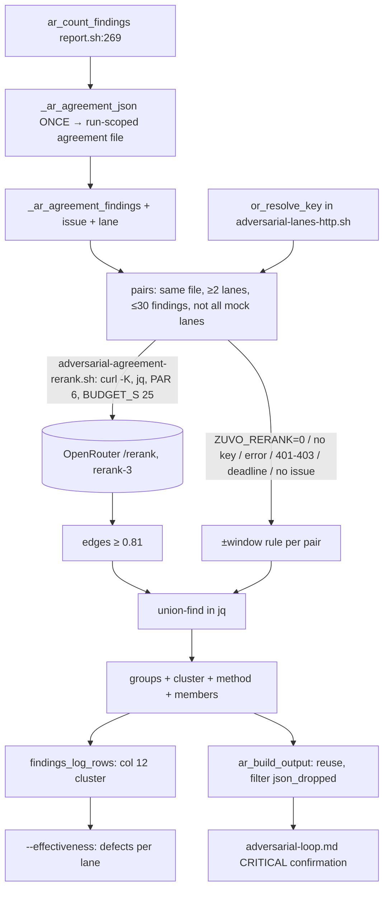

# Implementation Plan: rerank-based agreement grouping in adversarial review (Plan B)

**Spec:** inline — no spec (reranker campaign 2026-10-15, item 3)
**spec_id:** none
**planning_mode:** inline
**source_of_truth:** inline brief
**plan_revision:** 5
**status:** Approved
**Created:** 2026-10-15
**Tasks:** 5
**Estimated complexity:** 1 standard, 4 complex

> **Precondition met.** The CRITICAL-confirmation text this plan edits came with local commit `6072ff63`;
> `origin/main` carries it as `e7814cc3` (rebased, same subject). Branch from `origin/main` in a worktree
> (`zuvo:worktree`); local `main` and `8f7b9879` are not needed. Never the shared checkout.
>
> **Measured effect (corrects revision 1-3's D3).** On 130 hand-labelled cross-lane pairs the current
> ±5-line rule has precision **0.45** and recall **0.68**; `voyageai/rerank-3` at 0.81 has precision
> **0.91** and recall **0.82**. Both improve, so there is no recall trade-off to decide (revisions 1-3
> wrongly quoted a 0.98 window recall — that figure was token-Jaccard's). `.agreement` decides which
> CRITICALs count as confirmed (≥2 lanes in a group): fewer unrelated findings will falsely confirm one,
> and more reworded ones will truly confirm one.
>
> **Owner decision D3 (now only egress):** issue text (which can quote client code) goes to OpenRouter →
> Voyage when a key is present; `ZUVO_RERANK=0` opts out.
>
> **Tests:** the driver's hook suites run locally (`bash tests/hooks/<suite>.sh`; runbook §5 — farm
> false reds); `tests/adversarial/*` through `rt --light bash tests/adversarial/run.sh <names>`.
> **Telemetry format** is this plan's own invariant (shared with Plan A, which is not a dependency).

## Architecture Summary

`_ar_agreement_json` (`scripts/lib/adversarial-agreement.sh`, 98 lines) groups findings per file by
chaining lines within ±`ZUVO_ADV_AGREE_WINDOW` (5). It is called once per run, from one of the two
arms of an `if/else` (`adversarial-report.sh:429` JSON, `:463` text), after the ledger is written: Main runs
`ar_count_findings` (`adversarial-review.sh:417`, defined `adversarial-report.sh:269`) →
`findings_log_rows` (`adversarial-ledger.sh:514`) appends ledger rows → `ar_build_output` (`:419`,
defined `report.sh:377`) → the agreement. `json_dropped` is computed only inside `ar_build_output`
(`report.sh:405-418`). Per-lane stats count fingerprints: `--effectiveness`
(`adversarial-ledger.sh:159-223`) over the 11-column `adversarial-findings.log`, whose readers are
`adversarial-cli.sh`, `adversarial-ledger.sh`, `scripts/zuvo-home/bill`, `zuvo_bill_project.py`,
`zuvo_bill_state.py`, `zuvo_escapes_ledgerjoin.py`, `zuvo_review_ledger.py`.

The order of work therefore is: compute the agreement before the ledger append, with today's rule
(Task 2, behaviour-preserving) → only then switch the grouping to rerank (Task 3), so the ledger can
carry the cluster and a network-backed grouping never runs after the ledger.

Offline grouping in Bill was rejected: the ledger has no issue text (Bill would rank 3-5-word slugs),
Bill runs up to 48 h later and cannot help in-run triage, and Bill already groups judged runs itself.

## Technical Decisions

- **The endpoint contract is proven live** (2026-10-15 campaign: ~1 200 real calls to OpenRouter
  `POST /api/v1/rerank`, all Voyage models incl. `rerank-3`). Response:
  `{"model":…,"results":[{"index":i,"relevance_score":x,"document":{…}}],"usage":{"total_tokens":n,"cost":c}}`,
  results sorted by score. No pre-implementation spike; the fake curl replays this exact shape and
  SMOKE2 re-checks it live.
- **New module `scripts/lib/adversarial-agreement-rerank.sh`** (fan-out, deadline/reap, scoring,
  union-find). `adversarial-agreement.sh` keeps the window rule, the pair decision and the group shape.
  Registered in `AR_MODULES` (`adversarial-review.sh:281-283`) with its literal
  `. "$AR_LIB_DIR/adversarial-agreement-rerank.sh" || _ar_module_error …` load line before
  `adversarial-report.sh` (rule at `:341`). `or_resolve_key` lives in `adversarial-lanes-http.sh`, which
  the driver already loads before both agreement modules (all-or-nothing loader); the agreement suite
  sources it explicitly and a RED case pins that. It stays out of `AR_REQUIRED_FNS`
  (pinned, `test-adversarial-driver-modules.sh:135`).
- **jq + curl only** (`test-adversarial-agreement.sh:44-49` keeps python3 off PATH). Concurrency without
  `wait -n` (bash 3.2): the `jobs -rp` slot pool of `adversarial-input.sh:785-813`; one output file per
  query; at the deadline kill and reap.
- **Key:** `or_resolve_key` (from `run_openrouter`'s block `:211-244`; env → `ZUVO_OR_KEY_FILE` →
  `$HOME/.zuvo/openrouter.key`, mode 600/400, refuse quote/backslash/newline). Auth via
  `curl_auth_config` (`-K`, umask 077), never argv; the `-K` file removed after the run.
- **Base URL:** `ZUVO_RERANK_BASE_URL` (default `https://openrouter.ai/api/v1`), never
  `ZUVO_OPENROUTER_BASE_URL` (reused by the BytePlus lane).
- **The measured method, exactly:** doc `"<basename>: <id-slug with - as spaces>. <issue[:700]>"`; one call
  per finding (query = that finding, docs = later findings in the same file); only files where ≥2 lanes
  reported; ≤30 findings per file; edges where score ≥ `ZUVO_ADV_AGREE_RERANK_MIN` (0.81); union-find.
  Scored pairs are decided by score; unscored pairs (kill switch, no key, error, deadline, missing issue
  text, text-format lane) by the ±window rule.
- **Bounds and failure:** `ZUVO_ADV_AGREE_RERANK_PAR=6`, `--max-time 8` per call,
  `ZUVO_ADV_AGREE_RERANK_BUDGET_S=25`, `ZUVO_ADV_AGREE_RERANK_MAX_CALLS=60`; the first HTTP 401/402/403,
  or a second 429, stops launching further calls (running ones are reaped) — the rest fall back to the
  window. Kill switch `ZUVO_RERANK=0`. Rerank is skipped when every lane is `mock-*` (the guard
  `findings_log_rows` already uses).
- **No paid calls from test suites:** `tests/adversarial/run.sh` and the hook suites that drive the
  driver export `ZUVO_RERANK=0` and unset `OPENROUTER_API_KEY` / `ZUVO_OR_KEY_FILE`; new cases opt back
  in with a fake key and the fake curl.
- **Group shape (additive):** `{file, line_lo, line_hi, n_lanes, lanes, ids, max_severity}` + `cluster`
  ("c1"…), `method` ("rerank" | "window" | "mixed"), `members: [{lane, id}]`. Any jq error or bad
  response shape leaves those pairs unscored — the report always prints.
- **Before the ledger:** the agreement is computed inside `ar_count_findings` into a run-scoped file
  that also stores the per-pair decisions (window links; from Task 3 the scored edges).
  `ar_build_output` re-runs only the grouping (window chaining / union-find) over the members of
  non-dropped lanes, with no new calls — so a dropped lane can neither count toward the ≥2-lane
  confirmation nor bridge two other lanes into one group. If computing it fails, the file holds `null`
  (as `_ar_agreement_json` does today; `test-adversarial-agreement.sh` E1/S2 pin `null` = could not
  compute, `[]` = no findings) and the ledger append still runs with an empty cluster column.
- **Ledger:** 12th column `cluster` from `members` (lowest cluster on a collision), empty when ungrouped;
  both writers (JSON `@tsv` path and `findings_text_rows`). Defect key in `--effectiveness`:
  `(project, run_id, cluster)`; no cluster → `(project, run_id, fingerprint)`.
- **Telemetry (this plan's invariant):** per call, `${ZUVO_HOME}/rerank.log` gets the 7-field line
  `ts caller model n_docs latency_ms cost outcome` (caller `agreement`), each written by a single
  `printf >>`. The per-run comparison goes to a separate `${ZUVO_HOME}/rerank-agreement.log`:
  `ts run_id window_groups_ge2 rerank_groups_ge2 merged_by_window_only merged_by_rerank_only calls outcome`.
- Text-format `ISSUE:` lines are not parsed here; those pairs use the window rule.

## Quality Strategy

- **Mocking:** a fake `curl` in `$MOCKS` under `env -i` with the python-off stub first on PATH; it picks
  its response by a token in the `-d` body's `query` (never by request order), appends one line per
  request to a log read after reaping, replays the recorded live response shape, and uses `exec sleep N`
  for hangs. New cases use distinct issue texts; existing cases stay key-less and keep their pins.
- **Fixtures:** ~6 synthetic findings (zuvo is a public repo; campaign finding text is client data).
- **CQ gates:** CQ3 (response shape, issue-text escaping), CQ4 (key never in argv/logs/stderr), CQ5
  (egress documented, kill switch tested), CQ6 (≤30 per file, ≤60 calls, PAR 6, 700-char cut), CQ8
  (timeouts, abort on auth errors, window fallback), CQ14 (`or_resolve_key` shared), CQ19 (`.agreement`
  additive, 12-column ledger, readers tolerate both widths), CQ21 (one file per query, single-write log
  lines), CQ22 (jobs reaped, `-K` removed).

## Coverage Matrix

| Row ID | Authority item | Type | Primary task(s) | Notes |
|---|---|---|---|---|
| G1 | Within a file, merge only pairs with rerank-3 ≥ 0.81 | requirement | Task 3 | |
| G2 | Fallback to the ±5-line rule on any failure, per pair | requirement | Task 3 | |
| G3 | Parallel calls within a time cap | requirement | Task 3 | |
| G4 | Cluster id so per-lane stats count defects | requirement | Task 5 | members/cluster emitted in Task 3 |
| G5 | Offline-in-Bill alternative evaluated and documented | requirement | Task 4 | |
| G6 | Agreement computed once per run, before the ledger, dropped lanes excluded | requirement | Task 2 | |
| C1 | jq + curl only; python-off contract kept | constraint | Task 3 | |
| C2 | One key-resolution rule shared with the OpenRouter lane | constraint | Task 1 | |
| C3 | Key never in argv/logs; egress documented; `ZUVO_RERANK=0` works | constraint | Task 1, Task 3, Task 4 | |
| C4 | Grouping change measurable per run | constraint | Task 4 | exact counts tested |
| C5 | Test suites never make paid calls | constraint | Task 3 | |

## Review Trail
- Phase 1: Architect → Tech Lead → QA Engineer (full fan-out, shared with Plan A)
- Plan reviewer: revision 1 -> ISSUES FOUND (6) → revision 2; revision 2 -> ISSUES FOUND (4: json_dropped
  timing, paid calls from suites, Task 4 Verify, load line) → revision 3
- Cross-model validation (rev 2): ok, 5/5 providers (agy, codex-5.3, openrouter-3, claude, qwen),
  24 findings; triage:
  - fixed (restructured into revision 4): grouping-order/ledger risk scheduled last ×4 (CRITICAL ×3) —
    the before-the-ledger computation is now Task 2 with today's rule, before rerank exists (the
    "double rerank calls from two call sites" finding was later withdrawn: the two sites are if/else arms); D3 recall figure wrong (window recall 0.68, not 0.98); kill switch untested;
    telemetry counts unchecked ×3 and second log-line shape (separate `rerank-agreement.log`, exact
    counts); 401/429 abort; or_resolve_key availability to the new module (RED); missing Files
    (`adversarial-review.sh`, `test-log-schema-marker.sh`, the SMOKE2 checklist); ledger readers
    enumerated with a both-widths test; ledger append survives a failed grouping (RED); G4 moved off
    Task 3's proof; G5 proof checks the Bill paragraph; early end-to-end smoke in Task 3.
  - rejected: live-API spike ×4 (contract proven by ~1 200 live calls, recorded above); bash/jq
    feasibility spike (the slot pool already exists at `adversarial-input.sh:785-813`; union-find via
    `reduce` confirmed feasible by the plan reviewer).
- Plan reviewer: revision 4 -> ISSUES FOUND (3 MEDIUM: the agreement already runs once per run — RED now
  pins order before the ledger, "double calls" withdrawn; filtering by json_dropped let a dropped lane
  bridge two lanes — re-group stored pair decisions, bridge RED; failure must stay `null`, not `[]`;
  1 LOW: mock-only override knob named) → applied in revision 5; stop rule reached, no further loop
- Cross-model validation (rev 4): not re-run — the restructure was reviewed by the plan reviewer; one
  cross-model pass per plan (rev 2) per the stop rule
- Status gate: Approved (owner, 2026-10-15)

## Task Breakdown

### Task 1: One OpenRouter key-resolution function for the driver
**Files:** `scripts/lib/adversarial-lanes-http.sh`, `tests/adversarial/test-openrouter-response.sh`
**Surface:** backend-logic
**Complexity:** standard
**Dependencies:** none
**Failure:** halt
**Execution routing:** default implementation tier

- [ ] RED: in `test-openrouter-response.sh`, source `scripts/lib/adversarial-lanes-http.sh` directly and
  table-test `or_resolve_key`: env key; key file 600; key file 644 → refused with reason; quoted key →
  refused; no key → empty with `no-key`. Fails today: the function does not exist (catches the key rule
  drifting between the lane and the new caller).
- [ ] GREEN: move the key block (`:211-244`) into `or_resolve_key`; `run_openrouter` calls it and keeps
  `lane_no_key`, labels and the BytePlus guard unchanged. Not added to `AR_REQUIRED_FNS`.
- [ ] Verify: `rt --light bash tests/adversarial/run.sh test-openrouter-response test-openrouter-response-refactor-regression test-byteplus-billing-guard test-byteplus-stream test-lane-error-text test-provider-fanout-cap && bash tests/hooks/test-adversarial-driver-modules.sh`
  Expected: exit 0
- [ ] Acceptance Proof:
  - C2 / C3:
    - Surface: backend-logic
    - Proof: the verify command
    - Expected: exit 0
    - Artifact: `zuvo/proofs/task-1-report.md`
- [ ] Commit: `factor OpenRouter key resolution out of the lane so other callers share the rule`

### Task 2: Compute the agreement once per run, before the ledger, without dropped lanes
**Files:** `scripts/lib/adversarial-report.sh` (`ar_count_findings`, `ar_build_output`),
`scripts/lib/adversarial-agreement.sh` (`members`, `cluster`, `method: window`),
`tests/hooks/test-adversarial-agreement.sh`
**Surface:** backend-logic
**Complexity:** complex
**Dependencies:** none
**Failure:** halt
**Execution routing:** deep implementation tier

- [ ] RED: `the run-scoped agreement file exists when the first findings_log_rows call runs` (a wrapper
  records the order — fails today); `exactly one _ar_agreement_json invocation per run` (guards against
  leaving the old call in ar_build_output); `a jq-dropped lane is absent from .agreement and does not
  raise n_lanes`; `A~D and D~B bridged only by dropped lane D → A and B in separate groups`; `groups carry members [{lane,id}], cluster c1… and method window`; `if computing the
  agreement fails (unwritable run-scoped file) the file holds null and the ledger append still writes
  every row with an empty cluster`. T0's stub
  module keeps working (extend the stub with any new function it must provide). Existing J1 pins
  unchanged apart from the three additive keys.
- [ ] GREEN: `ar_count_findings` computes `_ar_agreement_json` into a run-scoped file before
  `findings_log_rows`; `ar_build_output` re-groups the stored pair decisions over non-dropped members
  (no recomputation of scores). `_ar_agreement_group` emits
  `members`, `cluster`, `method: "window"`. No network yet — behaviour otherwise identical.
- [ ] Verify: `bash tests/hooks/test-adversarial-agreement.sh && bash tests/hooks/test-adversarial-driver-modules.sh && rt --light bash tests/adversarial/run.sh test-findings-ledger`
  Expected: exit 0
- [ ] Acceptance Proof:
  - G6:
    - Surface: backend-logic
    - Proof: the verify command
    - Expected: exit 0; the once-per-run and dropped-lane tests pass
    - Artifact: `zuvo/proofs/task-2-report.md`
- [ ] Commit: `compute cross-lane agreement once per run, before the ledger, without dropped lanes`

### Task 3: Agreement groups by rerank score, falling back to the line window per pair
**Files:** `scripts/lib/adversarial-agreement-rerank.sh` (new), `scripts/lib/adversarial-agreement.sh`,
`scripts/adversarial-review.sh` (`AR_MODULES` + load line), `tests/hooks/test-adversarial-agreement.sh`,
`tests/adversarial/run.sh` (env scrub), `tests/fixtures/rerank/agreement/*.json` (synthetic)
**Surface:** backend-logic
**Complexity:** complex
**Dependencies:** Task 1, Task 2
**Failure:** halt
**Execution routing:** deep implementation tier

> Boundary justification: 3 production files (new module, grouping module, module list) + the agreement
> suite + the adversarial runner's env scrub. A new driver module must be registered in `AR_MODULES` in
> the same commit or the all-or-nothing loader refuses to start; the scrub must land in the commit that
> first makes a network call possible.

- [ ] RED (fake curl selecting by query token, `env -i`, python off, distinct issue texts):
  `lines 10 and 80 scored 0.9 → one group, method rerank, members name both lanes`;
  `lines 10 and 12 scored 0.4 → two groups`; `A~B and B~C high, A~C low → one cluster`;
  `curl exit 28 or no key → .agreement identical to the window result, method window`;
  `ZUVO_RERANK=0 with a valid key → 0 curl requests, window result`;
  `a key in the env + only mock lanes → 0 curl requests`; `same with
  ZUVO_ADV_AGREE_RERANK_ALLOW_MOCK=1 → a merged group` (the test-only knob SMOKE1 and the end-to-end RED
  use);
  `first 401 stops further requests; remaining pairs use the window`;
  `hanging curl (exec sleep) with BUDGET_S=2 → elapsed ≤ BUDGET_S + 3 s (SECONDS around the driver call),
  no orphan curl/sleep, no -K file in TMPDIR`;
  `out-of-range index or non-number score → those pairs unscored, report still prints`;
  `issue text with " \n and unicode → the -d body is valid JSON and cut at 700 chars`;
  `31 findings in one file → ≤30 per file and ≤ MAX_CALLS requests (counted after reaping)`;
  `argv log never contains the key`; `text-format lane (no issue) → window rule`;
  `the agreement harness resolves or_resolve_key from adversarial-lanes-http.sh`;
  minimal end-to-end: `adversarial-review.sh --mode code --json with two mock_json lanes, a fake key
  and the fake curl (mock-only skip overridden by the test) → one merged group`.
- [ ] GREEN: `_ar_agreement_findings` adds `issue` and the lane. The new module: candidate pairs per file,
  `jobs -rp` slot pool, one output file per query, deadline kill+reap, abort on auth errors, score
  collection in jq, union-find via `reduce`. `_ar_agreement_group` decides each pair by score or window.
  Register the module (AR_MODULES + load line); env scrub in `tests/adversarial/run.sh`;
  test-only `ZUVO_ADV_AGREE_RERANK_ALLOW_MOCK=1` lifts the mock-only skip.
- [ ] Verify: `bash tests/hooks/test-adversarial-agreement.sh && bash tests/hooks/test-adversarial-driver-modules.sh && rt --light bash tests/adversarial/run.sh test-findings-ledger test-provider-fanout-cap`
  Expected: exit 0
- [ ] Acceptance Proof:
  - G1 / G2 / G3 / C1 / C3 / C5:
    - Surface: backend-logic
    - Proof: the verify command
    - Expected: exit 0; existing J1 pins unchanged
    - Artifact: `zuvo/proofs/task-3-report.md`
- [ ] Commit: `group cross-lane findings by what they say, not only by how close their lines are`

### Task 4: Comparison telemetry and the triage docs
**Files:** `scripts/lib/adversarial-agreement.sh` (`_ar_print_agreement`),
`scripts/lib/adversarial-agreement-rerank.sh`, `shared/includes/adversarial-loop.md`,
`shared/includes/cross-provider-review.md`, `tests/hooks/test-adversarial-agreement.sh`
**Surface:** integration
**Complexity:** complex
**Dependencies:** Task 3
**Failure:** halt
**Execution routing:** deep implementation tier

- [ ] RED: on a fixture with one pair merged only by the window and one merged only by rerank:
  `rerank-agreement.log gets window_groups_ge2=1 rerank_groups_ge2=1 merged_by_window_only=1
  merged_by_rerank_only=1` (exact values); `rerank.log lines have exactly 7 fields, caller agreement`;
  `the text-mode AGREEMENT block names the method per group`.
- [ ] GREEN: compute the window grouping alongside (no I/O), write both logs (single `printf >>` per line),
  print `method` in `_ar_print_agreement` (defined in `adversarial-agreement.sh`, called at
  `report.sh:517`). `adversarial-loop.md` (`:262-300`) and `cross-provider-review.md:109`: grouping by
  rerank score with a per-pair window fallback; the threshold env; measured effect (precision 0.45 →
  0.91, recall 0.68 → 0.82); egress sentence and `ZUVO_RERANK=0`; a paragraph "Why not offline in Bill".
- [ ] Verify: `bash tests/hooks/test-adversarial-agreement.sh && bash tests/hooks/test-adversarial-driver-modules.sh && bash scripts/validate-skills.sh && grep -q "ZUVO_RERANK=0" shared/includes/adversarial-loop.md && grep -qi "offline in Bill" shared/includes/adversarial-loop.md`
  Expected: exit 0, `ERRORS: 0`
- [ ] Acceptance Proof:
  - G5 / C3 / C4:
    - Surface: integration
    - Proof: the verify command
    - Expected: exit 0
    - Artifact: `zuvo/proofs/task-4-report.md`
- [ ] Commit: `log rerank vs line-window agreement per run and describe the new grouping in triage`

### Task 5: Cluster id in the findings ledger; effectiveness counts defects; Plan B smoke
**Files:** `scripts/lib/adversarial-ledger.sh`, `scripts/zuvo-home/zuvo_review_ledger.py`,
`tests/adversarial/test-findings-ledger.sh`, `tests/adversarial/test-log-schema-marker.sh`,
`tests/hooks/test_review_shared.py`, `tests/hooks/test-rerank-agreement-smoke.sh` (new),
`zuvo/proofs/smoke-rerank-plan-b-live.md` (checklist)
**Surface:** db-data
**Complexity:** complex
**Dependencies:** Task 2, Task 3, Task 4
**Failure:** halt
**Execution routing:** deep implementation tier

> Boundary justification: 2 production files + 3 suites + the smoke runner. The column is written
> (ledger.sh) and read back (zuvo_review_ledger.py) in one commit, or the ledger and its readers
> disagree. Other readers (`adversarial-cli.sh`, `bill`, `zuvo_bill_project.py`, `zuvo_bill_state.py`,
> `zuvo_escapes_ledgerjoin.py`) are covered by a both-widths test and their existing suites.

- [ ] RED: `a run with a merged pair writes the same cluster on both lanes' rows, in both the JSON and
  the text writer`; `--effectiveness counts three lanes in one cluster as one defect and an 11-column row
  as its own defect`; `two runs that both use c1 count as two defects`; `ledger_header writes the #schema
  marker with the 12th column` (in `test-log-schema-marker.sh`); update the `NF != 11` / `NF == 11` pins
  (`test-findings-ledger.sh` lines 64, 255, 316); in `test_review_shared.py`: `LedgerRow exposes
  cluster, empty for 11-column rows`; `each ledger reader (bill status, escapes join, cli) accepts a file
  mixing 11- and 12-column rows`. `test-rerank-agreement-smoke.sh` runs SMOKE1.
- [ ] GREEN: both row writers append `cluster` from the run-scoped agreement (`members`, lowest cluster
  on a collision); `ledger_header` marker updated; `ar_cmd_effectiveness` adds a defects column per lane;
  `LedgerRow` gains `cluster: str = ""`; write the SMOKE2 checklist.
- [ ] Verify: `rt --light bash tests/adversarial/run.sh test-findings-ledger test-log-schema-marker && bash tests/hooks/test-adversarial-agreement.sh && bash tests/hooks/test-review-shared-unit.sh && bash tests/hooks/test-bill-unit.sh && bash tests/hooks/test-review-escapes-unit.sh && bash tests/hooks/test-rerank-agreement-smoke.sh && bash tests/hooks/test-adversarial-driver-modules.sh && test -s zuvo/proofs/smoke-rerank-plan-b-live.md && git add -N tests/hooks/test-rerank-agreement-smoke.sh && bash tests/hooks/test-python-lint.sh`
  Expected: exit 0
- [ ] Acceptance Proof:
  - G4 / SMOKE1:
    - Surface: db-data
    - Proof: the verify command
    - Expected: exit 0
    - Artifact: `zuvo/proofs/task-5-report.md`, `zuvo/proofs/smoke-rerank-plan-b.md`
  - SMOKE2 (manual, owner): gate — the PR is not marked ready until the owner fills in
    `zuvo/proofs/smoke-rerank-plan-b-live.md`.
- [ ] Commit: `record the agreement cluster per finding so lane stats count defects, not fingerprints`

After Task 5: runbook §1 sequence locally, ending with `bash tests/run-all.sh`.

## Whole-feature Smoke Proofs

- **SMOKE1 — one adversarial-review run with a merged and a split group**
  - Preconditions: temp HOME with a mode-600 key file; two `mock_json` lanes with `ZUVO_ADV_AGREE_RERANK_ALLOW_MOCK=1`;
    a fake curl scoring one cross-window pair 0.9 and one in-window pair 0.3 (by query token);
    `ZUVO_RERANK_BASE_URL` set.
  - Proof: `bash tests/hooks/test-rerank-agreement-smoke.sh` drives the real
    `adversarial-review.sh --mode code --json` on a fixture diff, then the text mode.
  - Expected: the cross-window pair in one group (`method: rerank`), the in-window pair split; the
    AGREEMENT block prints methods; both lanes' ledger rows of the merged pair share a cluster;
    `rerank-agreement.log` has the exact counts; no key in any captured argv.
  - Artifact: `zuvo/proofs/smoke-rerank-plan-b.md`
  - RED copies: Task 3 (minimal merged-group run), Task 5 (full).
- **SMOKE2 — one real review (manual, owner; gate before the PR is marked ready)**
  - Proof: a real `zuvo:review` on a small diff with the key present; `tail -3 ~/.zuvo/rerank.log
    ~/.zuvo/rerank-agreement.log`.
  - Expected: groups with `method: rerank`; spend well under $0.01; review time grows by < 10 s.
  - Artifact: `zuvo/proofs/smoke-rerank-plan-b-live.md`
