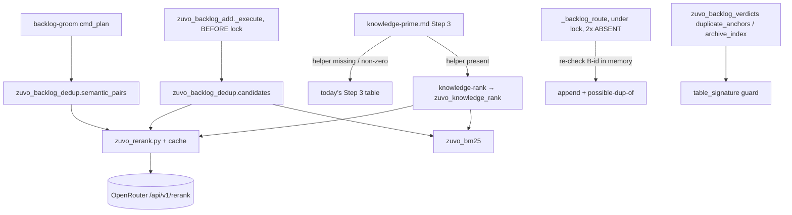

# Implementation Plan: API reranker for knowledge-prime and backlog dedup (Plan A)

**Spec:** inline — no spec (reranker campaign 2026-10-15, items 1-2)
**spec_id:** none
**planning_mode:** inline
**source_of_truth:** inline brief
**plan_revision:** 6
**status:** Approved
**Created:** 2026-10-15
**Tasks:** 6
**Estimated complexity:** 1 standard, 5 complex

> **Split (rule 17).** Item 3 (adversarial agreement grouping) is its own plan,
> `docs/specs/2026-10-15-rerank-adversarial-agreement-plan.md` (Plan B), because it edits the
> CRITICAL-confirmation contract introduced by the unpushed local commit 6072ff63. This plan ships as
> two stacked PRs: **PR-A1** = Tasks 1-3 (client + knowledge-prime), **PR-A2** = Tasks 4-6 (backlog).
>
> **Branch.** Never the shared checkout (91 dirty files from other agents, 50 commits behind
> `origin/main`; the backlog-add family exists only on `origin/main`). `zuvo:worktree` → branch off
> `origin/main`, then `rt --prepare`.
>
> **Tests.** Pure Python specs run on the farm (`rt --light python3 -m unittest …`). This repo's
> `tests/hooks/*` suites run **locally** (`bash tests/hooks/<suite>.sh`): the farm mirror has no `.git`,
> `~/.zuvo` or `memory/reviews/`, and docs/runbook/testing.md §5 documents them as false reds there.
>
> **Owner decisions (2026-10-15): D1 confirmed — flag only, bump opt-in. D2 resolved — on wherever a
> key is present, including TGM repos (code already reaches OpenRouter via adversarial lanes);
> `ZUVO_RERANK=0` turns it off.**
> - **D1 — no auto-merge at add time.** The brief said "≥0.72 → bump". This plan appends the entry
>   with `possible-dup-of: B-x (strong)` and lets groom report it; a bump happens only with
>   `ZUVO_BACKLOG_DEDUP_BUMP=1`. Why: at LOO-F1 0.89 roughly one strong match in ten is wrong, a wrong
>   bump hides a distinct finding inside another entry's `seen:` count, and `zuvo_backlog_apply`'s
>   rule is that a duplicate "is a REPORT, never a licence to merge".
> - **D2 — data egress.** Knowledge facts, backlog entry text (groom sends a whole backlog, up to 300
>   calls) go to OpenRouter → Voyage whenever a key is present, including client repos (TGM). The
>   opt-out is `ZUVO_RERANK=0`. Documented in the includes.

## Architecture Summary

Measured 2026-10-15 (campaign reports, hand-labelled gold sets):
- knowledge-prime: today's Step 3 recall@5 **0.48** (102/144 entries pass on the recency bonus alone;
  tags match by exact equality) → BM25 **0.83** → BM25 top-50 + `voyageai/rerank-2.5` **0.91**.
- backlog: today's exact keys catch **0/38** reworded duplicates; BM25 top-15 +
  `voyageai/rerank-2.5-lite` leave-one-out F1 **0.89** at threshold 0.72.
  **Correction (2026-10-15, raised by the ryzen-dev zuvo session that merged PR #80):** the 0/38 baseline
  is the legacy text key (`normalize_signature`/`entry_key`, `sha1(body[:200])`). None of the 18 820
  corpus entries carries the `F-` fingerprint (`sha1(CLASS|where|anchor)`) that `backlog-add` has
  used since 2026-10-14, so how many of the 38 that fingerprint would already merge was never measured.
  A rewording alone no longer splits an entry there; a different anchor within ±3 lines, class or
  file still does (backlog `B-20261015-DEDUP-ANCHOR-CHOICE-SPLITS`). Task 5 targets that remaining
  gap, and legacy/manual entries, groom (Task 6) and the Task 4 bug are unaffected. The 0.72
  threshold is calibrated on this gold set only; rerank scores are not probabilities.
- `normalize_signature` bug (confirmed by running it): on table rows whose Problem cell precedes the
  File cell, the signature is the basename + 8 words of metadata columns, so
  `| B-1 | race in cache invalidation | src/a.py:10 | WARNING | review |…` and
  `| B-2 | leaking file handle on error | src/a.py:90 | WARNING | review |…` share `fp:77f5d45a1fa9`.

Components:
- **`scripts/zuvo-home/zuvo_rerank.py` (new)** — the one Python client. `rerank(model, query, docs, *,
  timeout, caller) -> list[float] | None`; None on kill switch, no key, budget, timeout, HTTP error,
  bad JSON or bad shape; never raises. Cache: `zuvo_rerank_cache.py`. BM25: `zuvo_bm25.py`.
- **`knowledge-rank` (new CLI) + `zuvo_knowledge_rank.py`** — Steps 3+4 of knowledge-prime in one
  deterministic step; the agent keeps Steps 5-6 (`timesSurfaced` write).
- **Backlog:** a grouping-only `table_signature` guard in `zuvo_backlog_verdicts`; a pre-lock dedup
  candidate in `zuvo_backlog_add._execute`, re-checked in memory in `_backlog_route`'s double-ABSENT
  branch; a semantic pass in `backlog-groom.py cmd_plan` printing report lines only (no verdicts).
- Installer: none. `install.d/zuvo-home.sh` installs every file in `scripts/zuvo-home/`.

## Technical Decisions

- **Do not change `normalize_signature`, `entry_key` or `keys_for`.** It was tried and reverted
  (`zuvo_backlog_overlap.py:167`, backlog entry `B-20261005-BACKLOG-DUPLICATE-KEYS`): it rotated 154/821
  signatures (~1 250 fleet `fp:` keys) and H10 (`test-backlog-headings.sh:927-930`) pins `e.key` to a
  frozen snapshot. Fix where identity is used for grouping: `table_signature(entry)` (basename + first
  8 words of the problem cell — the longest cell after dropping id/path/severity/date/status cells)
  must also match when either entry is `KIND_TABLE`. A failed guard means "not a duplicate / not
  archived" — the safe direction. Also closes a false STALE_FIXED archival via `archive_index`.
- **Rerank never runs under the backlog lock.** `_lookup_timeout` leaves ~2 s for the fold and writes at
  the guaranteed `ZUVO_LOCK_WAIT ≥ 16 s`; rerank p90 is 2.1 s. Pre-check in `_execute` (route
  `ROUTE_BACKLOG` only, reads unlocked, 5 s timeout) → `c.dedup = (b_id, score, band) | None`; under
  the lock, only an in-memory check that the B-id is still defined.
- **`possible-dup-of` lives in the backlog line and `--json` only**, never in the text verdict line
  (pinned by `VERDICT_RE` and documented in `backlog-protocol.md`). Optional group between `ledger:` and
  the date; `fp:` identity identical with and without it.
- **Client key rule mirrors `adversarial-lanes-http.sh:212-236`:** `OPENROUTER_API_KEY`, then
  `ZUVO_OR_KEY_FILE`, then `$HOME/.zuvo/openrouter.key`; mode 600/400 only; refuse empty / quote /
  backslash / newline. The prototype's `_key()` (no mode check, raises) is not copied.
- **Base URL:** dedicated `ZUVO_RERANK_BASE_URL` (default `https://openrouter.ai/api/v1`). It must NOT
  inherit `ZUVO_OPENROUTER_BASE_URL`, which the BytePlus lane reuses (`adversarial-dispatch.sh:128`) —
  inheriting it could send rerank calls with the key to a non-OpenRouter host.
- **Kill switch `ZUVO_RERANK=0`.** Budget `ZUVO_RERANK_BUDGET_USD` (0.25/process) from `usage.cost`,
  with a call cap `ZUVO_RERANK_MAX_CALLS` (400/process) when `cost` is absent.
- **Cache:** one file per key, `${ZUVO_HOME:-$HOME/.zuvo}/cache/rerank/<sha[:2]>/<sha256>.json`, temp
  + rename; a corrupt shard is a miss; `prune(root, max_files=5000, max_age_s=30d)` called on ~1 write
  in 50 and testable directly.
- **Telemetry:** one TSV line per call in `${ZUVO_HOME}/rerank.log`:
  `ts caller model n_docs latency_ms cost outcome`; outcome ∈
  `ok|cached|disabled|no-key|budget|timeout|http-NNN|bad-json|bad-shape`; rotate to `.1` above 5 MB.
- **Thresholds are env-overridable constants:** `ZUVO_BACKLOG_DUP_HIGH=0.72`, `ZUVO_BACKLOG_DUP_LOW=0.55`
  (`rerank-2.5-lite`); `ZUVO_KNOWLEDGE_RERANK_MODEL=voyageai/rerank-2.5`, pool 50; groom
  `ZUVO_GROOM_RERANK_MAX=300`, ThreadPool(8).
- **knowledge-rank** with no keywords and no files (the using-zuvo session prime) skips BM25 and
  rerank and returns today's confidence/recency order — no egress. Reads legacy `content`/`implication`
  entries; never writes the store.
- **Lazy imports inside the backlog family.** The backlog suites build flat/mutant copies from the
  `zuvo_backlog_*.py` glob only (`test_backlog_add.py:181`, `test-backlog-grooming.sh:1713`,
  `test-backlog-grooming-smoke.sh:575`, `test-backlog-headings.sh:1609/2472/3977`). `zuvo_backlog_dedup`
  (imported by verdicts) and `zuvo_backlog_groom_semantic` therefore import `zuvo_rerank`/`zuvo_bm25`
  inside `candidates` / `semantic_pairs` only; `ImportError` → no candidate / `skipped:no-client`.
  Copies used by the new stub tests include `zuvo_rerank*.py` and `zuvo_bm25.py` explicitly, or the
  band tests would silently exercise the fail-open path.
- **`backlog-groom.py` stays under 400 raw lines** (FL1 in `test-backlog-grooming.sh` ~2740; it is 399
  today) and `cmd_plan` under 50 body lines (FL2, ~44 today): the semantic pass is ONE call into
  `zuvo_backlog_groom_semantic`, which prints every `SEMANTIC_*` line itself; an existing helper moves
  out of `backlog-groom.py` to make room (e.g. `_report_verdicts`, only if no `MUTATIONS` entry targets
  its text — the mutant factory's exactly-once guard makes a moved target a hard error).
- Stdlib only (`urllib.request`, `json`, `hashlib`, `fnmatch`, `concurrent.futures`); mypy 0 errors
  and ruff ratchet `MAX_RUFF=0` (`test-python-lint.sh` also lints the polyglot `knowledge-rank`).

| Path | New/Mod | Est. LOC |
|---|---|---|
| `scripts/zuvo-home/zuvo_rerank.py` | new | ~95 |
| `scripts/zuvo-home/zuvo_rerank_cache.py` | new | ~50 |
| `scripts/zuvo-home/zuvo_bm25.py` | new | ~45 |
| `scripts/zuvo-home/zuvo_knowledge_rank.py` | new | ~95 |
| `scripts/zuvo-home/knowledge-rank` | new (polyglot CLI, header from `backlog-groom.py:1-4`) | ~35 |
| `scripts/zuvo-home/zuvo_backlog_dedup.py` | new (`table_signature`, `candidates`) | ~80 |
| `scripts/zuvo-home/zuvo_backlog_groom_semantic.py` | new (`semantic_pairs`) | ~70 |
| `tests/lib/rerank_stub.py` | new test helper (stub HTTP server) | ~70 |

## Quality Strategy

- **HTTP mocking:** one shared local stub, `tests/lib/rerank_stub.py` — `http.server` on
  `127.0.0.1:0` in a thread, reached through `ZUVO_RERANK_BASE_URL`, with canned scores by query/doc
  substring, canned status/delay/body (delay keyable per query), request count and recorded bodies — a
  `ThreadingHTTPServer` (precedent:
  `tests/adversarial/test-provider-fanout-cap.sh:444-468`). Real server, not `mock.patch`: the CLI tests
  run subprocesses. Tests set `NO_PROXY=127.0.0.1` and clear `HTTP(S)_PROXY`. Temp HOME/ZUVO_HOME always.
- **No paid calls from test suites.** `test-backlog-grooming-smoke.sh` runs `backlog-groom.py` with the
  real HOME (line 627): it and `test-backlog-grooming.sh` export `ZUVO_RERANK=0`, asserting
  `SEMANTIC_DUPLICATES=skipped:disabled`.
- **zuvo is a public repo.** Fixtures are synthetic (~12 knowledge entries) or taken from zuvo's own
  public `memory/backlog.md`; the campaign gold sets (tgm-survey-platform knowledge, client finding
  text) are never copied. Each fixture < 5 KB, in `tests/fixtures/rerank/`.
- **CQ gates:** CQ3 (response shape, malformed JSONL, legacy schema), CQ4 (key mode, never in argv or
  logs), CQ5 (egress documented, `ZUVO_RERANK=0`), CQ6 (cache cap, log rotation, ≤50/≤15 docs, groom
  cap), CQ8 (timeouts, every failure → today's behaviour, exit codes unchanged), CQ14 (one client),
  CQ16 (budget + call-cap fallback), CQ19 (backlog line and `--json` shape; verdict line unchanged),
  CQ21 (cache temp+rename, lock re-check), CQ22 (stub server shut down in `tearDown`).
- **Recall is not a CI test** (against a stub it measures the stub). CI pins mechanics with fixed stub
  scores; the measured recall comes from the campaign and SMOKE (manual, real API).
- **Suites that must stay green:** A1-A3: `test-python-lint.sh`, `tests/gates/test-skill-structure.sh`,
  runbook §1 sequence. A4: `test-backlog-headings.sh` (H10/H17/H19c/H24), `test-backlog-grooming.sh`
  (Cc6/Cc8), `test-backlog-table-row-boundary.sh`, `test-backlog-archive-dedup.sh`,
  `test-backlog-unit.sh`. A5: `test-backlog-add.sh` (+ new spec in `REQUIRED`),
  `test-backlog-add-contract.sh`, `test-backlog-add-e2e.sh`. A6: grooming suites.

## Coverage Matrix

| Row ID | Authority item | Type | Primary task(s) | Notes |
|---|---|---|---|---|
| G1 | Shared API rerank client: key rule, fail-open, cache, budget, kill switch, telemetry | requirement | Task 1 | |
| G2 | knowledge-prime ranks by BM25 top-50 → rerank-2.5, file-glob boost, recency tie-break, section caps | requirement | Task 2, Task 3 | |
| G3 | knowledge-prime keeps today's Step 3 when the helper is missing | requirement | Task 3 | |
| G4 | Table-row signature bug fixed with a regression test that fails first | requirement | Task 4 | grouping-only guard, keys unchanged |
| G5 | Backlog add flags reworded duplicates (BM25 top-15 → rerank-2.5-lite, bands 0.72 / 0.55) | requirement | Task 5 | D1: append + flag; bump opt-in |
| G6 | Groom pass reports semantic duplicates (report lines only; never a verdict, queue row or ledger row) | requirement | Task 6 | |
| C1 | API only — no local models | constraint | Task 1 | |
| C2 | Fail-open: any failure keeps today's behaviour and exit codes | constraint | Task 1, Task 2, Task 5, Task 6 | |
| C3 | Never rerank under the backlog lock | constraint | Task 5 | |
| C4 | Tests never call the paid API; fixtures carry no client data | constraint | Task 1, Task 6 | |
| C5 | Egress documented with an opt-out | constraint | Task 3, Task 6 | D2 |

## Review Trail
- Phase 1: Architect → Tech Lead → QA Engineer (full fan-out, sequential)
- Plan reviewer: revision 3 -> ISSUES FOUND (1 MEDIUM: kill switch must be read before the lazy import,
  or glob-only copies print skipped:no-client; 1 LOW: Task 6 boundary note) → applied in revision 4;
  3-iteration cap reached, both fixes trivially correct, no further loop
- Plan reviewer: revision 2 -> ISSUES FOUND (2 HIGH: new rerank modules missing from the backlog suites'
  flat/mutant copies — lazy imports + explicit copies + a flat-copy RED; `backlog-groom.py` would cross
  FL1's 400-line gate — one-call wiring, a helper moved out, new modules joined to FL/Q0) → applied in
  revision 3
- Plan reviewer: revision 1 -> ISSUES FOUND (2 HIGH: groom semantic pairs entered verdicts/queue/ledger
  — now report lines only; SMOKE2 expected a dry-run to call the API — now a real add in a throwaway
  repo. 4 MEDIUM: lint never saw untracked new modules — `git add -N` first; backlog-add suites inherit
  the key env — scrubbed in Task 5; Task 6 deps 1/2; lock test non-deterministic — threaded stub,
  B starts after A's request is recorded. Minor: archive_index name) → applied in revision 2
- Plan reviewer: revision 5 -> ISSUES FOUND (1 MEDIUM: entry source for dedup would break H19c — one
  pinned iter_entries in the dedup loader, H19c arm + total 10, heading/table RED) → applied in revision
  6; stop rule reached
- Cross-model validation (rev 3): partial (3/5: agy, codex-5.3, claude; openrouter-3 and qwen timed out),
  18 findings; triage:
  - fixed: Task 1 concurrency test + lock; Task 2 → complex; G2/C2 proof orphans; Task 4 Verify missed
    test-backlog-add.sh; Task 5 stale-candidate re-check now compares a body hash; Task 5 Verify runs the
    shared-parser suites; PR-A1 carries its own smoke (knowledge half in Task 3); SMOKE2 is a gate before
    PR-A2 is marked ready; `_report_verdicts` mutation check recorded as verified.
  - rejected: live-API spike (contract proven by ~1 200 live calls); `archive_index` first-match only
    (the guard only removes matches — comparing fewer entries can only keep today's behaviour); unittest
    "exit 0 theater" (`python -m unittest` exits non-zero on failure and on zero tests run).
  - accepted as notes (stop rule, no re-split): Task 5/6 bundling (boundary justifications recorded);
    D1/D2 are resolved by the owner at approval and written into the header before execution.
- Status gate: Approved (owner, 2026-10-15)

## Task Breakdown

### Task 1: Shared rerank client with cache, BM25 and a test stub server
**Files:** `scripts/zuvo-home/zuvo_rerank.py`, `scripts/zuvo-home/zuvo_rerank_cache.py`,
`scripts/zuvo-home/zuvo_bm25.py`, `tests/lib/rerank_stub.py`, `tests/hooks/test_rerank_client.py`,
`tests/hooks/test-rerank-client.sh`
**Surface:** backend-logic
**Complexity:** complex
**Dependencies:** none
**Failure:** halt
**Execution routing:** deep implementation tier

> Boundary justification: 3 small production modules (~190 LOC total) + a test helper + one spec and
> its wrapper. Client, cache and BM25 are the shared foundation every later task imports; the stub is
> the only way to test them.

- [ ] RED: `test_rerank_client.py` (stub server, temp HOME/ZUVO_HOME):
  - `scores map back by index, not response order` (stub returns sorted by score).
  - `different doc order or model gives a different cache key`; `a cache hit makes no request and logs
    outcome=cached`.
  - bad-response table, each → None and no exception: HTTP 500, error body on 200, duplicate index,
    missing index, NaN score, wrong length, truncated JSON, stub delay > timeout.
  - key table: none → None + `no-key` + 0 requests; mode-644 file, empty key, quoted key → refused.
  - `ZUVO_RERANK=0 makes no request`; budget spent → None; response without `usage.cost` → call cap stops.
  - `rerank.log line has 7 fields and never the key`; seeded >5 MB log rotates to `.1`.
  - `prune removes files older than 30 days and enforces the count cap`; `a corrupt shard is a miss`.
  - `ZUVO_OPENROUTER_BASE_URL is ignored` (catches rerank following the BytePlus override).
  - BM25 table: empty query / empty corpus → input order, no ZeroDivision; absent term → 0; unicode.
  - `8 threads against a tiny budget and call cap never exceed the cap, and every rerank.log line has 7
    fields` (catches races on the shared counters and log; the groom pass calls from 8 threads).
- [ ] GREEN: `zuvo_rerank.rerank(model, query, docs, *, timeout=5.0, caller) -> list[float] | None`;
  `zuvo_rerank_cache.get/put/prune`; `zuvo_bm25.top_k(query, docs, k)` (k1=1.5, b=0.75). Budget and
  call-cap counters behind a `threading.Lock`; each log line written with one `write` under that lock. Rules as in
  Technical Decisions. `test-rerank-client.sh` runs the spec (run-all globs `test-*.sh`).
- [ ] Verify: `rt --light python3 -m unittest -v tests/hooks/test_rerank_client.py && git add -N scripts/zuvo-home/zuvo_rerank.py scripts/zuvo-home/zuvo_rerank_cache.py scripts/zuvo-home/zuvo_bm25.py tests/lib/rerank_stub.py tests/hooks/test_rerank_client.py && bash tests/hooks/test-python-lint.sh`
  Expected: exit 0
- [ ] Acceptance Proof:
  - G1 / C1 / C2 / C4:
    - Surface: backend-logic
    - Proof: the verify command
    - Expected: exit 0; key-leak, kill-switch, budget and base-URL tests among the passes
    - Artifact: `zuvo/proofs/task-1-report.md`
- [ ] Commit: `add one rerank client for zuvo helpers: OpenRouter, cached, budgeted, never fatal`

### Task 2: knowledge-rank helper
**Files:** `scripts/zuvo-home/zuvo_knowledge_rank.py`, `scripts/zuvo-home/knowledge-rank`,
`tests/hooks/test_knowledge_rank.py`, `tests/hooks/test-knowledge-rank.sh`,
`tests/fixtures/rerank/knowledge/*.jsonl` (synthetic, ~12 entries)
**Surface:** backend-logic
**Complexity:** complex
**Dependencies:** Task 1
**Failure:** halt
**Execution routing:** deep implementation tier

- [ ] RED: `test_knowledge_rank.py` (stub, fixture store copied to a temp `MAIN_ROOT`):
  `malformed JSONL line is skipped and the store is byte-identical afterwards` (catches the helper
  writing the store); `legacy content/implication entry is ranked`; `no key → BM25 order, exit 0`;
  `no keywords and no files → confidence/recency order and 0 requests` (catches the session prime
  sending data out); `60-entry corpus → stub receives exactly 50 docs`; `stub scores reorder past the BM25
  order`; `equal scores → the affectedFiles glob match ranks first; recency only breaks ties`;
  `Step 4 section caps hold`.
- [ ] GREEN: `knowledge-rank --root <MAIN_ROOT> --keywords <csv> [--files <newline list>] [--k N] --json`
  → `[{id, type, section, score}]`. Loads `knowledge/*.jsonl`, BM25 over tags + fact + recommendation
  (legacy: content + implication), top 50 → `zuvo_rerank.rerank(ZUVO_KNOWLEDGE_RERANK_MODEL, …)` →
  glob boost → recency tie-break → Step 4 caps. Rerank None → BM25 order.
- [ ] Verify: `rt --light python3 -m unittest -v tests/hooks/test_knowledge_rank.py && git add -N scripts/zuvo-home/zuvo_knowledge_rank.py scripts/zuvo-home/knowledge-rank tests/hooks/test_knowledge_rank.py && bash tests/hooks/test-python-lint.sh`
  Expected: exit 0
- [ ] Acceptance Proof:
  - G2 / C2:
    - Surface: backend-logic
    - Proof: the verify command
    - Expected: exit 0
    - Artifact: `zuvo/proofs/task-2-report.md`
- [ ] Commit: `rank knowledge entries by relevance to the task instead of by recency`

### Task 3: knowledge-prime Step 3 calls the helper, today's table stays as fallback
**Files:** `shared/includes/knowledge-prime.md`, `tests/hooks/test_knowledge_rank.py`,
`tests/hooks/test-rerank-smoke.sh` (new: the knowledge-prime half of SMOKE1, so PR-A1 carries its own smoke)
**Surface:** docs
**Complexity:** standard
**Dependencies:** Task 2
**Failure:** halt
**Execution routing:** default implementation tier

- [ ] RED: one test in `test_knowledge_rank.py` extracts the command line from `knowledge-prime.md`
  Step 3 and runs it against the fixture (catches the doc and the helper's flags drifting apart). No
  tests on prose.
- [ ] GREEN: Step 3: "if `~/.zuvo/knowledge-rank` exists, run `<exact command>` and use its order;
  if it is missing or exits non-zero, apply the table below" — today's table kept verbatim. Step 4 notes
  the helper already applied the caps. Add the egress sentence (knowledge facts go to OpenRouter when a
  key is present; `ZUVO_RERANK=0` opts out).
- [ ] Verify: `rt --light python3 -m unittest -v tests/hooks/test_knowledge_rank.py && bash scripts/validate-skills.sh && bash tests/gates/test-skill-structure.sh && bash tests/hooks/test-rerank-smoke.sh`
  Expected: exit 0, `ERRORS: 0`
- [ ] Acceptance Proof:
  - G2 / G3 / C5 / SMOKE1 (knowledge half):
    - Surface: docs
    - Proof: the verify command, plus `grep -q "ZUVO_RERANK=0" shared/includes/knowledge-prime.md`
    - Expected: exit 0
    - Artifact: `zuvo/proofs/task-3-report.md`
- [ ] Commit: `knowledge-prime: let the ranking helper pick entries, keep the old scoring as fallback`

### Task 4: Table rows no longer pair or archive through a metadata-only signature
**Files:** `scripts/zuvo-home/zuvo_backlog_dedup.py` (new: `table_signature`),
`scripts/zuvo-home/zuvo_backlog_verdicts.py`, `tests/hooks/test_backlog_dedup.py` (new),
`tests/hooks/test-backlog-add.sh` (`REQUIRED` += `test_backlog_dedup.py`)
**Surface:** backend-logic
**Complexity:** complex
**Dependencies:** none
**Failure:** halt
**Execution routing:** deep implementation tier

- [ ] RED — **commit the tests alone first, run them on the unmodified `zuvo_backlog_verdicts.py`, record
  the FAIL in the report**: `B-1/B-2 table rows with the same file are not paired by duplicate_anchors,
  and both entry_keys stay fp:77f5d45a1fa9`; `an open table row is not marked STALE_FIXED by an archived
  table row sharing its fp:`; control: `two table rows that really are the same still pair`;
  `checkbox entries are unaffected`.
- [ ] GREEN: `table_signature(entry)` in `zuvo_backlog_dedup.py`; `duplicate_anchors` and the
  `archive_index` match (`zuvo_backlog_verdicts.py:187`) require equal table signatures when either
  entry is `KIND_TABLE`. `archive_index` keeps only the first archived entry per key (`setdefault`), so
  the guard compares against that entry only — the safe direction. Never adds a match, only removes
  one. Keys untouched.
- [ ] Verify: `rt --light python3 -m unittest -v tests/hooks/test_backlog_dedup.py && bash tests/hooks/test-backlog-headings.sh && bash tests/hooks/test-backlog-grooming.sh && bash tests/hooks/test-backlog-table-row-boundary.sh && bash tests/hooks/test-backlog-archive-dedup.sh && bash tests/hooks/test-backlog-unit.sh && bash tests/hooks/test-backlog-add.sh && git add -N scripts/zuvo-home/zuvo_backlog_dedup.py tests/hooks/test_backlog_dedup.py && bash tests/hooks/test-python-lint.sh`
  Expected: exit 0 (H10 green)
- [ ] Acceptance Proof:
  - G4:
    - Surface: backend-logic
    - Proof: the RED run on pre-fix code (FAIL recorded) + the verify command
    - Expected: RED fails before, verify exits 0 after
    - Artifact: `zuvo/proofs/task-4-report.md`
- [ ] Commit (two): `test: table rows paired by a metadata-only signature` then
  `stop pairing and archiving table rows whose signature is only metadata`

### Task 5: backlog-add flags reworded duplicates without touching the lock budget
**Files:** `scripts/zuvo-home/zuvo_backlog_dedup.py` (`candidates`), `scripts/zuvo-home/zuvo_backlog_add.py`,
`scripts/zuvo-home/zuvo_backlog_entry.py`, `tests/hooks/test_backlog_dedup.py`,
`tests/fixtures/rerank/backlog/*.md` (pairs from zuvo's public `memory/backlog.md`),
`tests/hooks/test_backlog_add.py`, `tests/hooks/test-backlog-add-contract.sh`,
`tests/hooks/test-backlog-add-e2e.sh`, `tests/hooks/test-backlog-headings.sh` (env scrub + H19c arm)

> Boundary justification: 3 production files + the new spec. The four existing suites change by one
> env line each (`ZUVO_RERANK=0`, unset `OPENROUTER_API_KEY` / `ZUVO_OR_KEY_FILE`): they drive
> `backlog-add` with the parent env (`test_backlog_add.py:117`, `-contract.sh:451`, `-e2e.sh:58`), so
> from this task on they would otherwise send test findings to the real API.
**Surface:** backend-logic
**Complexity:** complex
**Dependencies:** Task 1, Task 4
**Failure:** halt
**Execution routing:** deep implementation tier

- [ ] RED (stub, through the `backlog-add` launcher unless noted):
  `score ≥0.72 → appended with possible-dup-of strong, seen unchanged`; `same with
  ZUVO_BACKLOG_DEDUP_BUMP=1 → bumped`; `0.55–0.72 → weak`; `<0.55 → no field`;
  `stub 500 or timeout → same verdict, exit code and backlog bytes as today`;
  `the lock is not held during the network call` (stub is a `ThreadingHTTPServer` with a 4 s delay
  keyed to A's query only; start add B only after the stub has recorded A's request; B with
  `ZUVO_LOCK_WAIT=2` must finish in under 4 s); in-process: `candidate B-id gone, or its body changed, by lock time → ACCEPTED, no field`; `a heading or table
  candidate whose body is unchanged keeps the flag`; `--dry-run makes 0 requests`; `forced ZUVO_BACKLOG_ADMIT is never redirected`;
  `rendered line with the field passes parse_own and self_check, same fp: with and without it, an exact
  repeat still reaches OPEN and bumps`; `text verdict line carries no possible-dup-of`; `a flat copy without zuvo_rerank.py behaves exactly as
  today, exit 0` (catches a top-level import breaking every mutant/flat copy); `OPENROUTER_API_KEY in the parent env + the suites'
  env → 0 requests` (`ZUVO_RERANK_BASE_URL` pointed at the stub, request count 0).
- [ ] GREEN: the entry source is ONE pinned `zb.iter_entries(text, kinds=<explicit tuple>)` in a
  `zuvo_backlog_dedup` loader, used both before the lock and for the lock-time re-check, hashing
  `Entry.body` on both sides (`zuvo_backlog_add.py` itself still never calls `iter_entries` — H19c's
  `*)` arm). In `test-backlog-headings.sh` H19c add the arm `zuvo_backlog_dedup.py) want="1 0 - 0 0 -"`
  and raise the family's pinned-call total from 9 to 10.
  `candidates(entries, text) -> (b_id, score, band) | None` (BM25 top-15 over open + archived
  → `rerank-2.5-lite`; `zuvo_bm25`/`zuvo_rerank` imported inside the function, `ImportError` → None).
  The flat dir built by `test_backlog_add.py:181` `flat()` also copies `zuvo_rerank*.py` and
  `zuvo_bm25.py` for the stub-backed cases. `_execute` computes `c.dedup` before `_locked` when route is `ROUTE_BACKLOG`;
  `_backlog_route`'s double-ABSENT branch re-checks in memory that the candidate B-id is still defined in
  `zio.read(c.real)` / the archive text AND that its body hashes to the value scored before the lock
  (a changed body drops the flag), then `_append_backlog` with the field, or `_bump` when opted in and strong. `render`, `_OWN_RE`,
  `_bumped` accept the optional group; `--json` gains `possible_dup_of`. `_lookup_timeout` untouched.
- [ ] Verify: `rt --light python3 -m unittest -v tests/hooks/test_backlog_dedup.py && bash tests/hooks/test-backlog-add.sh && bash tests/hooks/test-backlog-add-contract.sh && bash tests/hooks/test-backlog-add-e2e.sh && bash tests/hooks/test-backlog-headings.sh && bash tests/hooks/test-backlog-grooming.sh && bash tests/hooks/test-backlog-archive-dedup.sh && bash tests/hooks/test-backlog-unit.sh && bash tests/hooks/test-backlog-table-row-boundary.sh && bash tests/hooks/test-python-lint.sh`
  Expected: exit 0
- [ ] Acceptance Proof:
  - G5 / C2 / C3:
    - Surface: backend-logic
    - Proof: the verify command
    - Expected: exit 0; the lock-not-held and fail-open tests pass
    - Artifact: `zuvo/proofs/task-5-report.md`
- [ ] Commit: `flag reworded backlog duplicates at add time, outside the lock, without merging them`

### Task 6: Groom reports semantic duplicates; Plan A smoke
**Files:** `scripts/zuvo-home/zuvo_backlog_groom_semantic.py` (new), `scripts/zuvo-home/backlog-groom.py`,
`shared/includes/backlog-protocol.md` (egress + `possible-dup-of` note),
`tests/hooks/test_backlog_dedup.py`, `tests/hooks/test-backlog-grooming.sh`,
`tests/hooks/test-backlog-grooming-smoke.sh`, `tests/hooks/test-rerank-smoke.sh` (extends Task 3's runner with the backlog half),
`scripts/zuvo-home/zuvo_backlog_render.py` (receives `_report_verdicts`, moved out of `backlog-groom.py`)
**Surface:** integration
**Complexity:** complex
**Dependencies:** Task 1, Task 2, Task 3, Task 5
**Failure:** halt
**Execution routing:** deep implementation tier

> Boundary justification: 3 production files (the new module, the launcher, `zuvo_backlog_render.py`)
> + 1 include + the two grooming suites that must stop calling the paid API in the same commit the pass
> appears + the smoke runner. The `_report_verdicts` move cannot be separated: without it the one-call
> wiring pushes the launcher past FL1's 400-line gate.

- [ ] RED: `an entry with a semantic duplicate is still dispatched (its queue row verdict is None)`;
  `an entry with a deterministic verdict gets no semantic report`; `a second plan run without a key does
  not reuse a semantic report as a decided verdict`; `the report line names both entries' id:/fp: keys`;
  `no key → SEMANTIC_DUPLICATES=skipped:no-key and an identical verdict set`; `stub request count ≤
  ZUVO_GROOM_RERANK_MAX`; `a pair classify already found is not reported twice`; `a glob-only copy with ZUVO_RERANK=0 prints
  skipped:disabled, not skipped:no-client`. Both grooming suites
  export `ZUVO_RERANK=0` and assert `SEMANTIC_DUPLICATES=skipped:disabled`. `test-rerank-smoke.sh` runs
  SMOKE1.
- [ ] GREEN: wiring in `cmd_plan` is one call (≤ 6 lines) into `zuvo_backlog_groom_semantic`, which
  prints all `SEMANTIC_*` lines; move `_report_verdicts` (`backlog-groom.py:209`, ~15 lines; no grooming-suite
  mutation targets it on origin/main — re-check `MUTATIONS` first) into `zuvo_backlog_render.py` so the
  launcher stays < 400 raw lines; add `zuvo_backlog_groom_semantic.py` and
  `zuvo_backlog_dedup.py` to the FL loop and the Q0 file list (`test-backlog-grooming.sh:1148-1150`);
  imports of `zuvo_rerank`/`zuvo_bm25` inside `semantic_pairs` only, and only AFTER the
  `ZUVO_RERANK=0` check (the grooming suites run glob-only copies without `zuvo_rerank`).
  `semantic_pairs(entries, *, max_calls, workers=8)` → pairs ≥ `ZUVO_BACKLOG_DUP_HIGH`,
  skipping entries that already carry a deterministic verdict. `cmd_plan` runs it after `zv.classify`
  (kept pure) and prints them ONLY as report lines
  `SEMANTIC_DUPLICATE=<lineno> <key> <other key> <score>` plus
  `SEMANTIC_DUPLICATES=<n>|skipped:<outcome>`. They never enter the `verdicts` list, `queue_row`, the
  groom ledger or `plan_reuse` — a ~0.89-F1 guess must not be stamped `deterministic:duplicate`, must not
  stop the entry reaching the verifier, and must not be reused by a later keyless run. `backlog-protocol.md`: the `possible-dup-of` field, the egress sentence,
  `ZUVO_RERANK=0`.
- [ ] Verify: `rt --light python3 -m unittest -v tests/hooks/test_backlog_dedup.py && bash tests/hooks/test-backlog-grooming.sh && bash tests/hooks/test-backlog-grooming-smoke.sh && bash tests/hooks/test-rerank-smoke.sh && git add -N scripts/zuvo-home/zuvo_backlog_groom_semantic.py tests/hooks/test-rerank-smoke.sh && bash tests/hooks/test-python-lint.sh`
  Expected: exit 0; `wc -l < scripts/zuvo-home/backlog-groom.py` < 400; FL2 green
- [ ] Acceptance Proof:
  - G6 / C2 / C4 / C5 / SMOKE1:
    - Surface: integration
    - Proof: the verify command, plus `grep -q "ZUVO_RERANK=0" shared/includes/backlog-protocol.md`
    - Expected: exit 0
    - Artifact: `zuvo/proofs/task-6-report.md`, `zuvo/proofs/smoke-rerank-plan-a.md`
  - SMOKE2 (manual, owner, real API): gate — PR-A2 is not marked ready until the owner fills in the
    checklist Task 6 writes to `zuvo/proofs/smoke-rerank-plan-a-live.md`.
- [ ] Commit: `groom reports reworded duplicate pairs; suites never call the paid API`

After Task 6: runbook §1 sequence locally — `bash scripts/validate-skills.sh`, `gen-gate-copies`,
`gate-consistency`, `registry-integrity`, `bash tests/run-all.sh`.

## Whole-feature Smoke Proofs

- **SMOKE1 — knowledge-prime and backlog-add against a stub API**
  - Preconditions: temp HOME with a mode-600 key file; `tests/lib/rerank_stub.py` on a free port;
    `ZUVO_RERANK_BASE_URL` pointing at it; temp git repo with the fixture knowledge store.
  - Proof: `bash tests/hooks/test-rerank-smoke.sh` — (1) runs the exact Step 3 command from
    `knowledge-prime.md` on the fixture store; (2) `backlog-add` of a finding, then of a reworded
    duplicate (stub score 0.8); (3) the same with `ZUVO_BACKLOG_DEDUP_BUMP=1`; (4) `ZUVO_RERANK=0` repeat.
  - Expected: (1) JSON order follows the stub, caps hold; (2) second line carries
    `possible-dup-of: <first B-id>` strong; (3) `seen=2`; (4) no stub requests, today's behaviour.
  - Artifact: `zuvo/proofs/smoke-rerank-plan-a.md`
  - RED copies: Task 3 (knowledge half), Task 6 (backlog half).
- **SMOKE2 — real API, owner's machine (manual)**
  - Proof: `~/.zuvo/knowledge-rank --root ~/DEV/tgm-survey-platform --keywords "<a real task>" --json`;
    one real (non-dry) `backlog-add` of a reworded existing finding into a throwaway copy of a repo
    (`--dry-run` is cache-only by design); `tail ~/.zuvo/rerank.log`.
  - Expected: plausible top-5; strong `possible-dup-of`; log lines with cost; total spend < $0.01.
  - Artifact: `zuvo/proofs/smoke-rerank-plan-a-live.md`
